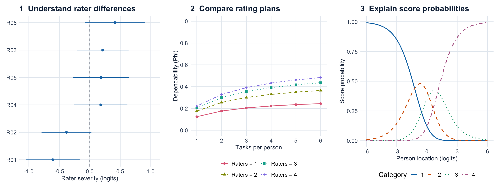
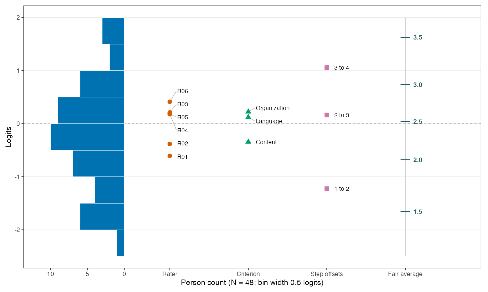

# mfrmr 

[](https://github.com/Ryuya-dot-com/mfrmr)
[](https://github.com/Ryuya-dot-com/mfrmr/actions/workflows/R-CMD-check.yaml)
[](https://github.com/Ryuya-dot-com/mfrmr/actions/workflows/pkgdown.yaml)
[](https://opensource.org/licenses/MIT)

**Account for rater differences. Plan your assessment. Diagnose rating quality.**

The same performance can receive different scores from different raters.
For speaking assessments, essays, clinical OSCEs, and other rubric-scored work, `mfrmr` connects three tasks:

1. **Measurement models (`fit_mfrm()`, `fit_mfrm_drift()`, `mfrm_batch_fit()`):** estimate examinee ability while accounting for rater severity, task or criterion difficulty, step thresholds (`RSM`, `PCM`, and constrained hybrids), element covariates, and 1- or 2-family discrimination slopes (`GPCM`) via high-speed C++ `MML` (`EAP` and Warm's `WLE`), `JML`, `JML_jeffreys`, and `CML`.
2. **G-Study and D-Study planning (`mfrm_g_study()`, `mfrm_d_study()`):** decompose observed-score variance across crossed or nested facets and multivariate composites (`ANOVA`, `MINQUE(0)`, and non-iterative Henderson Method 1 `urGENOVA`) to project generalizability ($G$), dependability ($\Phi$), and standard errors across candidate designs.
3. **Rater feedback and decision support (`diagnose_mfrm()`, `fair_average_table()`, `estimate_bias()`, `analyze_dff()`, `classification_table()`, `interrater_agreement()`):** inspect `Infit`/`Outfit` `MnSq` and `ZSTD`, `ModelSE` vs `RealSE`, rubric-scale `Fair(M)`, FACETS 4.5.3 `RajuSA-Welch` pairwise bias contrasts, parallel split-element DFF, and cut-score classification accuracy.

For pipeable end-to-end workflows, `tidy()`/`glance()`/`augment()` extractors, and reproducible Markdown/HTML/Word APA & individual rater feedback reports, pair `mfrmr` with the companion **`tidymfrm`** package.

[](https://ryuya-dot-com.github.io/mfrmr/)

## Install and open tutorials

```r
install.packages("mfrmr")
browseVignettes("mfrmr")
```

Core offline vignettes bundled with `mfrmr`:

- `vignette("mfrmr-workflow", package = "mfrmr")`: Connectivity audit, fast C++ `RSM`/`PCM`/`GPCM` estimation, `predict()`, CVD-safe `plot()`, and batch replications.
- `vignette("mfrmr-gtheory", package = "mfrmr")`: Crossed, nested, and multivariate `G-Study` / `D-Study` planning.

## Try one assessment

Start with synthetic operational data for **48 people, six raters, and three criteria** (`Score` from 1 to 4, where 4 denotes higher performance). Each person is assigned two raters; 282 of 288 planned ratings are observed:

```r
library(mfrmr)
ratings <- load_mfrmr_data("example_operational")
head(ratings[c("Person", "Rater", "Criterion", "Score")], 3)
```

| Person | Rater | Criterion | Score |
| --- | --- | --- | --- |
| P001 | R01 | Language | 4 |
| P001 | R01 | Organization | 2 |
| P001 | R02 | Content | 4 |

**One row is one observed rating.** Missing assignments are absent rows, not zeros.

### 1. Audit connectivity and fit the measurement model

```r
# Verify multi-facet graph connectivity before estimation
conn <- check_mfrm_connectivity(
  ratings,
  person = "Person",
  facets = c("Rater", "Criterion"),
  score = "Score"
)
conn$connected

# Fit Rating Scale Model (RSM) via MML with Warm's (1989) WLE person scoring
fit <- fit_mfrm(
  ratings,
  person = "Person",
  facets = c("Rater", "Criterion"),
  score = "Score",
  model = "RSM",
  method = "MML",
  person_score = "WLE"
)
print(fit)
fit$facets[, c("Facet", "Level", "ObsCount", "Estimate", "ModelSE", "RealSE", "FairM", "InfitMnSq")]
```

Non-person facets carry negative sign (`Sign = -1`) by default so **higher rater estimates denote stricter (more severe) scoring** and **higher criterion estimates denote harder criteria**. Use standard S3 methods to extract intervals, covariances, and predictions under arbitrary conditions:

```r
confint(fit, component = "facets", se_type = "real")
predict(fit, newdata = data.frame(theta = c(-1, 0, 1), Rater = "R01", Criterion = "Content"))
```

### 2. Read the color-vision-safe `ggplot2` diagnostics

Every `plot()` method returns a customizable `ggplot` object using color-vision-safe `"okabe_ito"`, `"viridis"`, or strict grayscale `"monochrome"` palettes paired with distinct point `shape` and `linetype` encodings:

```r
plot(fit, type = "wright", palette = "okabe_ito")
plot(fit, type = "raters", palette = "monochrome")
plot(fit, type = "category_curves", palette = "viridis")
```



### 3. Screen bias, DFF, and plan future designs (`G-Study` / `D-Study`)

```r
# FACETS 4.5.3 RajuSA-Welch 2-way local bias & pairwise contrasts
bias <- estimate_bias(fit, interaction_facets = c("Rater", "Criterion"), df_method = "facets")
head(bias$pairwise, 4)

# Observed-score Generalizability & Decision Study (Henderson Method 1 / urGENOVA)
gt <- mfrm_g_study(
  ratings,
  scores = "Score",
  person = "Person",
  facets = c("Rater", "Criterion"),
  method = "urgenova"
)
mfrm_d_study(gt, design_grid = expand.grid(Rater = 1:4, Criterion = 2:4))
confint(gt)
```

Before interpreting intervals or classification, inspect
`summary(fit)$readiness`: optimizer convergence alone does not establish usable
inference. Prediction SEs condition on the supplied or fitted person ability.
For unbalanced G-Studies, intervals use a Gaussian plug-in covariance for the
actual assignments and remain approximations; unidentified designs are rejected.
See `?"mfrmr-s3-methods"` for these uncertainty definitions and `?fair_average_table`
for comparisons under an explicit common reference panel.

## Core 22-function public API

| Pillar | Entry points |
| --- | --- |
| Data & connectivity | `load_mfrmr_data()`, `describe_mfrm_data()`, `check_mfrm_connectivity()`, `interrater_agreement()` |
| Calibration, GPCM, & linking | `fit_mfrm()`, `mfrm_batch_fit()`, `fit_mfrm_drift()`, `compare_mfrm()`, `apply_empirical_bayes_shrinkage()`, `make_anchor_table()`, `anchor_to_baseline()`, `detect_anchor_drift()`, `read_mfrm_posterior()` |
| Diagnostics, bias, DFF, & cuts | `diagnose_mfrm()`, `fair_average_table()`, `compute_person_fit_indices()`, `compute_information()`, `classification_table()`, `estimate_bias()`, `analyze_dff()` |
| G-Study & D-Study | `mfrm_g_study()`, `mfrm_d_study()` |
| Standard S3 generics | `predict()`, `coef()`, `vcov()`, `confint()`, `anova()`, `plot()`, `summary()`, `print()`, `fitted()`, `residuals()`, `logLik()`, `AIC()`, `BIC()`, `nobs()`, `as.data.frame()` |

## Scope and citation

Statistical fit indices (`Infit`/`Outfit`), severity estimates, and DFF contrasts support formative rater training, rubric clarification, and targeted second-scoring; they must not be used for automated high-stakes rater exclusion without qualitative review (Eckes, 2015). Observed-score $G$ and $\Phi$ decompose raw score variance (Brennan, 2001) and answer different questions from model-adjusted latent reliability.

Use `citation("mfrmr")` and see [NEWS.md](NEWS.md) and [ROADMAP.md](ROADMAP.md). Licensed under the [MIT License](https://opensource.org/licenses/MIT).

`mfrmr` has benefited from discussion and methodological input from Dr. Atsushi Mizumoto and Dr. Taichi Yamashita.
