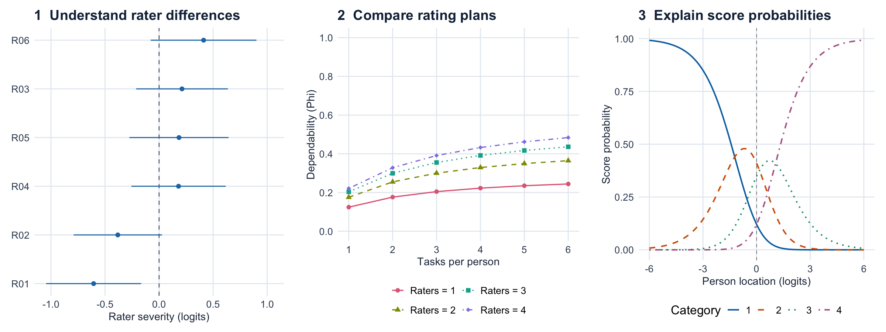
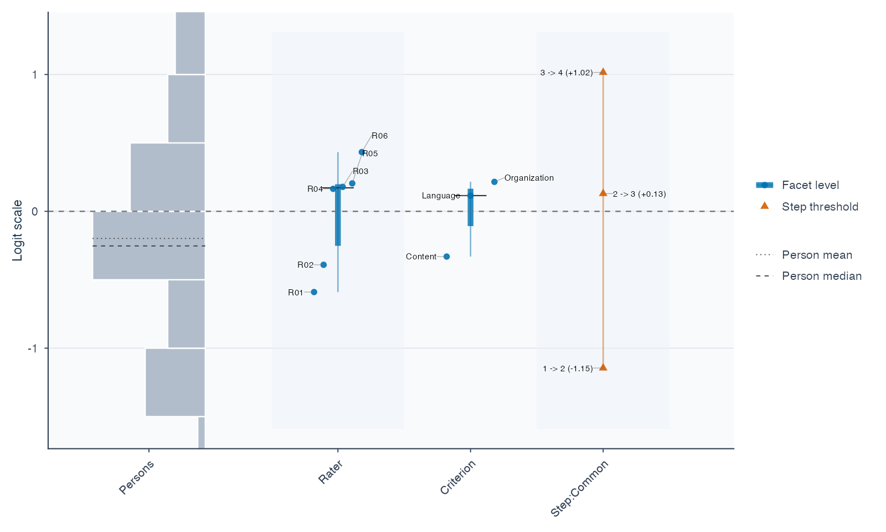

# mfrmr 

[](https://github.com/Ryuya-dot-com/mfrmr)
[](https://github.com/Ryuya-dot-com/mfrmr/actions/workflows/R-CMD-check.yaml)
[](https://github.com/Ryuya-dot-com/mfrmr/actions/workflows/pkgdown.yaml)
[](https://opensource.org/licenses/MIT)


**Account for rater differences. Plan your assessment. Report the results.**

The same performance can receive different scores from different raters.
For speaking performances, essays and other rated work, `mfrmr` helps you:

- **Measure performance:** estimate person ability while accounting for rater
  severity and task or criterion difficulty.
- **Plan ratings:** compare what adding raters or tasks would do to score precision.
- **Explain results:** examine agreement and prepare tables, figures and reports
  for researchers or raters.

[](https://ryuya-dot-com.github.io/mfrmr/articles/visual-gallery.html)

**[Explore the published interactive gallery (0.2.4)](https://ryuya-dot-com.github.io/mfrmr/articles/visual-gallery.html)**:
inspect values, compare rating plans, and reuse the ggplot2 code in your report.

## Install and choose matching documentation

**The CRAN release is 0.2.4 (published 2026-10-30).** Install it with:

```r
install.packages("mfrmr")
browseVignettes("mfrmr")
```

The [published documentation website](https://ryuya-dot-com.github.io/mfrmr/)
currently describes **0.2.4**. Use those tutorials with that release.

**The examples below describe development toward 0.3.0 (`0.2.4.9000`).**
To install this development revision from a source checkout, follow the
[source-build steps](CONTRIBUTING.md#building-from-a-checkout-with-retained-research-results)
to produce `mfrmr_0.2.4.9000.tar.gz`, including the five core tutorials.
Building tutorials requires R Markdown and Pandoc. Then, from the directory
containing that archive, install it in R:

```r
install.packages("mfrmr_0.2.4.9000.tar.gz", repos = NULL, type = "source")
```

Source installation requires R build tools. Check `packageVersion("mfrmr")`
in a fresh R session before following the examples. Before updating existing
scripts, open `help("mfrmr_api_migration_030")`.
The development source includes five core offline tutorials: workflow, model
choice, G theory, visual diagnostics and reporting. The commands below open
documentation for the installed version. The main website documents the
published release; development articles are built separately under `dev/`.
Until a website build matches your checkout, use its installed help and local
article sources in `vignettes/articles/`. The new visual tour is
`vignettes/articles/mfrmr.Rmd` in this checkout.

## Try one assessment

Start with synthetic data for **48 people, six raters and three criteria**.
Each person is assigned two raters; 282 of 288 planned ratings are observed.
Here, interpret 1 as lower performance and 4 as higher performance.

```r
library(mfrmr)
ratings <- load_mfrmr_data("example_operational")
head(ratings[c("Person", "Rater", "Criterion", "Score")], 3)
```

| Person | Rater | Criterion | Score |
| --- | --- | --- | --- |
| P001 | R01 | Language | 4 |
| P001 | R01 | Organization | 2 |
| P001 | R02 | Content | 4 |

**One row is one observed rating.** Missing ratings are absent rows, not zeros.
A *facet* is a source of variation: here, the rater and assessment criterion.

Fit a rating-scale model (RSM), which uses shared category steps across criteria,
by marginal maximum likelihood (MML). For your assessment, see the
`vignette("mfrmr-model-choice", package = "mfrmr")`.

```r
fit <- fit_mfrm(
  ratings, person = "Person", facets = c("Rater", "Criterion"), score = "Score",
  rating_min = 1, rating_max = 4, category_policy = "preserve",
  method = "MML", model = "RSM",
  population_formula = ~ 1, person_data = unique(ratings["Person"])
)

analysis <- mfrm_results(fit, include = "publication")  # Gather diagnostics and tables
check <- summary(analysis)
check$decision[, c("FormalInference", "NextAction")]
```

This example estimates the ability population's mean and SD while centering
rater, criterion and step parameters. The legacy RSM/PCM defaults instead fix
the population to N(0,1) **and** center all these locations. That combination
constrains the overall score level as well as the population spread; it is
appropriate only when those assumptions are intended. See `?fit_mfrm` for
mean-only estimation and alternative location constraints.

Here, `FormalInference` is `No`: estimation completes, but the current
estimated-population route does not complete the fit-readiness identification
review. Treat the estimates and figure below as descriptive, and inspect
`check$decision` before using an interval or making an inferential claim.
Even `Yes` means only that the implemented numerical and precision-method
checks pass under the chosen model; it does not establish model adequacy,
finite-sample coverage for your design, or construct validity. Ordinary
RSM/PCM Stan export currently requires a fixed N(0,1) population; it rejects
this estimated-population fit rather than silently changing its model.

## Read the first figure

```r
plot(fit, show_ci = FALSE)
```



Start with **Rater**: R01 is about −0.59 and R06 about +0.43 logits.
Higher rater locations mean lower expected scores for the same person and
criterion, so R06 is estimated to score more severely. Zero is a centered
reference, not a quality standard; point estimates alone do not establish
a statistically significant difference. The IQR bars describe spread, not uncertainty.

The left panel shows person estimates; other columns show criteria and category
steps. Open `vignette("mfrmr-visual-diagnostics", package = "mfrmr")` for interpretation.
State what high scores mean: *difficulty in understanding* and *ease of
understanding* run in opposite directions.

## Make a report and keep the analysis

```r
report <- mfrm_report(analysis, style = "apa", output = "html")
browseURL(report$path)  # Open the draft report in your browser
export_mfrm_results(analysis, output_dir = "assessment-export", preset = "starter")
```

The report combines results, checks and draft wording; the export saves tables,
available figures and a reloadable analysis. Open `assessment-export/index.html`
to navigate the saved files. Add your study question, sampling,
rubric and interpretation. Review person-level information before sharing.

`vignette("mfrmr-reporting-and-apa", package = "mfrmr")`
introduces three editable manuscript templates:

| Your question | Template |
| --- | --- |
| Report a one-family GPCM analysis | `gpcm-report.Rmd`: measures, precision, fit, agreement and figures. |
| Compare rater/task plans | `gtheory-report.Rmd`: sources of variation, plans and uncertainty. |
| Review anchors, bias or model choice | `assessment-review.Rmd`: select the relevant modules. |

Templates require R Markdown and Pandoc; the HTML report above does not.
The guide distinguishes separation, Strata and reliability from observed
agreement (Krippendorff's alpha and pairwise Cohen's kappa).

## Choose your next task

Run these commands in the R session using the version installed above.
For the [visual tour](https://ryuya-dot-com.github.io/mfrmr/dev/articles/mfrmr.html),
use the development website's **Get started** entry or
`vignettes/articles/mfrmr.Rmd` in the matching source checkout.

| Task | Documentation for your installed version |
| --- | --- |
| Use your own CSV | `vignette("mfrmr-workflow", package = "mfrmr")` |
| Plan the number of raters or tasks | `vignette("mfrmr-gtheory", package = "mfrmr")` |
| Interpret facet intervals | `help("mfrm_facet_intervals")` |
| Review rating networks and residual patterns | `help("mfrm_network_analysis")`; `help("mfrm_residual_network")` |
| Choose a model | `vignette("mfrmr-model-choice", package = "mfrmr")`; `help("mfrmr_gpcm_scope")` |
| Reuse a calibration or compare external software | `help("mfrm_calibration_workflow")`; `help("facets_guide")`; `help("build_conquest_overlap_bundle")` |
| Continue in Stan/brms and report saved estimates | `help("export_mfrm_model")`; `help("read_mfrm_posterior")` |

In R, use `mfrmr_output_guide("beginner")` to choose an entry point.

## Updating, scope and citation

Installing a new version does not update saved calculations. Keep originals
and follow [NEWS](NEWS.md) and `help("mfrmr_api_migration_030")` for the
0.2.4-to-0.3.0 transition. Earlier saved-object guidance remains in
`help("mfrmr_workflow_methods")`. For retired drawing helpers, see
`help("mfrmr_plot_migration")`; `plot()` is the main entry point.

Native measurement models use one ordered score scale and one latent person
dimension. Two-family GPCM and other experimental routes have separate limits
in the model guides. G/D studies concern variation in defined observed scores.
The [roadmap](ROADMAP.md) separates current capabilities from future work.

Use `citation("mfrmr")` and the methodological references in the relevant help.
For reproducible numerical checks, historical results and their limits, see
the [validation evidence guide](https://github.com/Ryuya-dot-com/mfrmr/blob/main/inst/validation/README.md). A passing software
test is distinct from a repeated-sampling coverage study.
Licensed under the [MIT License](https://opensource.org/licenses/MIT).

`mfrmr` has benefited from discussion and methodological input from
[Dr. Atsushi Mizumoto](https://mizumot.com/) and
[Dr. Taichi Yamashita](https://kugakujo.kansai-u.ac.jp/html/100000882_en.html).
