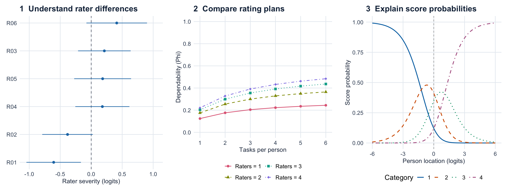
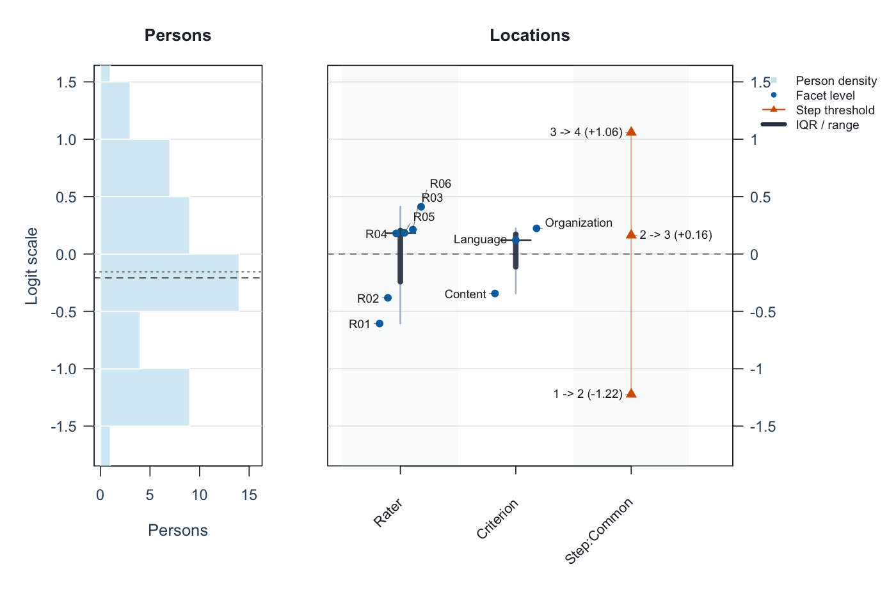

# mfrmr 

[](https://github.com/Ryuya-dot-com/mfrmr)
[](https://github.com/Ryuya-dot-com/mfrmr/actions/workflows/R-CMD-check.yaml)
[](https://github.com/Ryuya-dot-com/mfrmr/actions/workflows/pkgdown.yaml)
[](https://opensource.org/licenses/MIT)


**Account for rater differences. Plan your assessment. Report the results.**

The same performance can receive different scores from different raters.
For speaking performances, essays and other rated work, `mfrmr` helps you:

- **Measure performance:** estimate person ability while accounting for rater
  severity and task or criterion difficulty.
- **Plan ratings:** compare what adding raters or tasks would do to score precision.
- **Explain results:** examine agreement and prepare tables, figures and reports
  for researchers or raters.

[](https://ryuya-dot-com.github.io/mfrmr/articles/visual-gallery.html)

**[Explore the interactive gallery](https://ryuya-dot-com.github.io/mfrmr/articles/visual-gallery.html)**:
inspect values, compare rating plans, and reuse the ggplot2 code in your report.

## Install the version used here

**These examples require the unreleased 0.2.4 candidate.** If the maintainer
has supplied its `.tar.gz` archive, select it here:

```r
install.packages(file.choose(), repos = NULL, type = "source")
```

Source installation requires R build tools. Keep the archive and checksum:
different candidates share version `0.2.4`. Without the candidate, use
`install.packages("mfrmr")` for the CRAN release and follow its installed
tutorials via `browseVignettes("mfrmr")`; some features below will be unavailable.

## Try one assessment

Start with synthetic data for **48 people, six raters and three criteria**.
Each person is assigned two raters; 282 of 288 planned ratings are observed.
Here, interpret 1 as lower performance and 4 as higher performance.

```r
library(mfrmr)
ratings <- load_mfrmr_data("example_operational")
head(ratings[c("Person", "Rater", "Criterion", "Score")], 3)
```

| Person | Rater | Criterion | Score |
| --- | --- | --- | --- |
| P001 | R01 | Language | 4 |
| P001 | R01 | Organization | 2 |
| P001 | R02 | Content | 4 |

**One row is one observed rating.** Missing ratings are absent rows, not zeros.
A *facet* is a source of variation: here, the rater and assessment criterion.

Fit a rating-scale model (RSM), which uses shared category steps across criteria,
by marginal maximum likelihood (MML). For your assessment, see the
[model-choice guide](https://ryuya-dot-com.github.io/mfrmr/articles/mfrmr-model-choice.html).

```r
fit <- fit_mfrm(
  ratings, person = "Person", facets = c("Rater", "Criterion"), score = "Score",
  rating_min = 1, rating_max = 4, category_policy = "preserve",
  method = "MML", model = "RSM"
)

analysis <- mfrm_results(fit, include = "publication")  # Gather diagnostics and tables
check <- summary(analysis)
check$decision[, c("FormalInference", "NextAction")]
```

Here, `FormalInference` is `Yes`: the implemented inference checks pass.
If it is `No` for your data, follow `NextAction` before making inferential claims.
Passing these checks does not establish construct validity.

## Read the first figure

```r
plot(fit, show_ci = FALSE)
```



Start with **Rater**: R01 is about −0.61 and R06 about +0.41 logits.
Higher rater locations mean lower expected scores for the same person and
criterion, so R06 is estimated to score more strictly. Zero is a centered
reference, not a quality standard; point estimates alone do not establish
a statistically significant difference. The IQR bars describe spread, not uncertainty.

The left panel shows person estimates; other columns show criteria and category
steps. See the [visual guide](https://ryuya-dot-com.github.io/mfrmr/articles/mfrmr-visual-diagnostics.html).
State what high scores mean: *difficulty in understanding* and *ease of
understanding* run in opposite directions.

## Make a report and keep the analysis

```r
report <- mfrm_report(analysis, style = "apa", output = "html")
browseURL(report$path)  # Open the draft report in your browser
export_mfrm_results(analysis, output_dir = "assessment-export", preset = "starter")
```

The report combines results, checks and draft wording; the export saves tables,
available figures and a reloadable analysis. Open `assessment-export/index.html`
to navigate the saved files. Add your study question, sampling,
rubric and interpretation. Review person-level information before sharing.

The [reporting guide](https://ryuya-dot-com.github.io/mfrmr/articles/mfrmr-reporting-and-apa.html)
introduces three editable manuscript templates:

| Your question | Template |
| --- | --- |
| Report a one-family GPCM analysis | `gpcm-report.Rmd`: measures, precision, fit, agreement and figures. |
| Compare rater/task plans | `gtheory-report.Rmd`: sources of variation, plans and uncertainty. |
| Review anchors, bias or model choice | `assessment-review.Rmd`: select the relevant modules. |

Templates require R Markdown and Pandoc; the HTML report above does not.
The guide distinguishes separation, Strata and reliability from observed
agreement (Krippendorff's alpha and pairwise Cohen's kappa).

## Choose your next task

| Task | Guide |
| --- | --- |
| Use your own CSV | [Data-to-report workflow](https://ryuya-dot-com.github.io/mfrmr/articles/mfrmr-workflow.html) |
| Plan the number of raters or tasks | [G-theory and assessment design](https://ryuya-dot-com.github.io/mfrmr/articles/mfrmr-gtheory.html) |
| Review agreement and rater differences | [Agreement](https://ryuya-dot-com.github.io/mfrmr/articles/mfrmr-rating-agreement.html); [rater intervals](https://ryuya-dot-com.github.io/mfrmr/articles/mfrmr-facet-intervals.html) |
| Check rating links; explore residual patterns | [Networks and reporting](https://ryuya-dot-com.github.io/mfrmr/articles/mfrmr-networks-and-reporting.html) |
| Choose a model | [Model choice](https://ryuya-dot-com.github.io/mfrmr/articles/mfrmr-model-choice.html); [GPCM scope](https://ryuya-dot-com.github.io/mfrmr/articles/mfrmr-gpcm-scope.html) |
| Reuse a calibration or move from other software | [Portable calibration](https://ryuya-dot-com.github.io/mfrmr/articles/mfrmr-portable-calibration.html); [FACETS migration](https://ryuya-dot-com.github.io/mfrmr/articles/mfrmr-facets-migration.html); `?build_conquest_overlap_bundle` |
| Continue in Stan/brms and report saved estimates | [Model export](https://ryuya-dot-com.github.io/mfrmr/reference/export_mfrm_model.html); [return to figures and reports](https://ryuya-dot-com.github.io/mfrmr/reference/read_mfrm_posterior.html) |

In R, use `mfrmr_output_guide("beginner")` to choose an entry point.
The public website may be older; `browseVignettes("mfrmr")` matches your installation.

## Updating, scope and citation

Installing a new version does not update saved calculations. Keep originals
and follow [NEWS](NEWS.md) and **Updating saved analyses for 0.2.4** in
`help("mfrmr_workflow_methods")`. For retired drawing helpers, see
`help("mfrmr_plot_migration")`; `plot()` is the main entry point.

Native measurement models use one ordered score scale and one latent person
dimension. Two-family GPCM and other experimental routes have separate limits
in the model guides. G/D studies concern variation in defined observed scores.
The [roadmap](ROADMAP.md) separates current capabilities from future work.

Use `citation("mfrmr")` and the methodological references in the relevant help.
Licensed under the [MIT License](https://opensource.org/licenses/MIT).

`mfrmr` has benefited from discussion and methodological input from
[Dr. Atsushi Mizumoto](https://mizumot.com/) and
[Dr. Taichi Yamashita](https://kugakujo.kansai-u.ac.jp/html/100000882_en.html).
