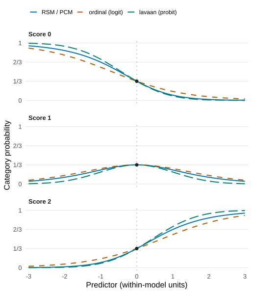

```{r setup, include = FALSE}
knitr::opts_chunk$set(
  collapse = TRUE,
  comment = "#>",
  fig.width = 8,
  fig.height = 4.6,
  dpi = 110,
  out.width = "100%"
)
has_ggplot2 <- requireNamespace("ggplot2", quietly = TRUE)
has_igraph <- requireNamespace("igraph", quietly = TRUE)
has_kable <- requireNamespace("kableExtra", quietly = TRUE)
has_plotly <- requireNamespace("plotly", quietly = TRUE)
```

```{r apa-helpers, include = FALSE}
# Tables and figures are numbered in the order they appear on the page.
new_counter <- function() {
  n <- 0L
  function() {
    n <<- n + 1L
    n
  }
}
next_table <- new_counter()
next_figure <- new_counter()

# Lay out an mfrmr apa_table() result as an APA-style HTML table:
# number in bold, title in italics, horizontal rules only, note below.
apa_html <- function(x, columns = NULL, labels = NULL, digits = 2,
                     integers = NULL, bounded = NULL) {
  tab <- as.data.frame(x$table)
  if (!is.null(columns)) tab <- tab[, columns, drop = FALSE]
  numeric <- vapply(tab, is.numeric, logical(1))
  # Fixed decimals (2.00, not 2), whole numbers for counts, no leading zero
  # for statistics that cannot exceed 1, and a true minus sign.
  for (j in names(tab)[numeric]) {
    whole <- is.integer(tab[[j]]) || j %in% integers
    value <- formatC(tab[[j]], digits = if (whole) 0 else digits, format = "f")
    if (j %in% bounded) value <- sub("^(-?)0\\.", "\\1.", value)
    tab[[j]] <- sub("^-", "−", value)
  }
  if (!is.null(labels)) names(tab) <- labels
  title <- sub("^Table [0-9]+\\s*\\n", "", x$caption)
  out <- kableExtra::kbl(tab, format = "html",
    row.names = FALSE, align = ifelse(numeric, "r", "l"), escape = FALSE,
    table.attr = 'class="apa-table" style=""',
    caption = sprintf("<strong>Table %d</strong><br><em>%s</em>",
      next_table(), title))
  if (length(x$note) && nzchar(x$note)) {
    out <- kableExtra::footnote(out, general = x$note,
      general_title = "Note.", footnote_as_chunk = TRUE)
  }
  out
}

# APA figure heading: number in bold, title in italics, placed above the figure.
apa_figure <- function(title) {
  sprintf("<strong>Figure %d</strong><br><em>%s</em>", next_figure(), title)
}
apa_widget <- function(widget, title) {
  htmltools::tagList(
    htmltools::HTML(sprintf('<p class="apa-figure-title">%s</p>', apa_figure(title))),
    widget
  )
}

# APA number format for statistics bounded by 1: no leading zero.
apa_coef <- function(x, digits = 3) {
  out <- formatC(x, digits = digits, format = "f")
  out <- sub("^(-?)0\\.", "\\1.", out)
  sub("^-", "−", out)
}
```

```{r page-style, echo = FALSE, results = "asis"}
cat('
<style>
.mfrmr-tour{display:grid;grid-template-columns:repeat(auto-fit,minmax(155px,1fr));gap:.5rem;margin:1rem 0 1.5rem}
.mfrmr-tour a{display:block;border:1px solid var(--bs-border-color,#dee2e6);border-radius:.5rem;padding:.55rem .7rem;font-size:.92rem;line-height:1.25;text-decoration:none;color:inherit;transition:border-color .15s ease,background-color .15s ease}
.mfrmr-tour a:hover{border-color:#1f6f8b;color:#1f6f8b;text-decoration:none}
.mfrmr-tour b{display:inline-block;width:1.5rem;height:1.5rem;margin-right:.45rem;border-radius:50%;background:#1f6f8b;color:#fff;text-align:center;font-size:.8rem;line-height:1.5rem}
details.mfrmr-code{margin:.4rem 0 1rem}
details.mfrmr-code summary{cursor:pointer;font-size:.88rem;color:var(--bs-secondary-color,#6c757d);user-select:none}
details.mfrmr-code summary:hover{color:#1f6f8b}
table.apa-table{width:auto;max-width:100%;margin:1.4rem 0 1.8rem;border-collapse:collapse;font-variant-numeric:tabular-nums}
table.apa-table thead tr:first-child th{border-top:1px solid var(--bs-body-color,#212529)!important}
table.apa-table caption{caption-side:top;text-align:left;color:var(--bs-body-color,#212529);padding:0 0 .55rem;font-size:1rem;line-height:1.5}
table.apa-table th{font-weight:400;padding:.35rem .9rem;border:0;border-bottom:1px solid var(--bs-body-color,#212529)!important;text-align:center!important;vertical-align:bottom}
table.apa-table td{padding:.22rem .9rem;border:0!important;background:transparent!important}
table.apa-table tbody tr:last-child td{border-bottom:1px solid var(--bs-body-color,#212529)!important}
table.apa-table tfoot td{padding:.5rem 0 0!important;font-size:.88rem;text-align:left;white-space:normal}
.figure,.section .figure{display:flex;flex-direction:column}
.figure .caption,p.apa-figure-title{order:-1;text-align:left;margin:1.4rem 0 .5rem;font-size:1rem;line-height:1.5;color:var(--bs-body-color,#212529)}
</style>
<script>
document.addEventListener("shown.bs.tab", function () {
  window.dispatchEvent(new Event("resize"));
});
</script>
')
```

Ratings of essays, speeches and performances depend on **who** scored them and
**what** was scored, not only on the person being assessed. A many-facet
Rasch model (MFRM) places persons, raters, criteria and tasks on one common
scale, so that a person's measure is adjusted for the raters and criteria
they happened to receive.

This page is a guided tour. It does not replace the tutorials; each section
ends with a link to the article that explains the method, its assumptions and
its references. All data on this page are synthetic teaching data bundled with
the package. Tables and figures follow APA style; figures marked
*interactive* show values when you hover over them.

```{r tour-map, echo = FALSE, results = "asis"}
cat('
<div class="mfrmr-tour">
<a href="#why-adjust"><b>1</b>Why adjust for raters?</a>
<a href="#look-at-data"><b>2</b>Look at the data</a>
<a href="#design-network"><b>3</b>See the design as a network</a>
<a href="#wright-map-scale"><b>4</b>One common scale</a>
<a href="#rsm-pcm-gpcm"><b>5</b>RSM, PCM and GPCM</a>
<a href="#rater-feedback"><b>6</b>Feedback for raters</a>
<a href="#g-and-d-studies"><b>7</b>Plan with G- and D-studies</a>
<a href="#report-in-apa-style"><b>8</b>Report in APA style</a>
<a href="#other-software"><b>9</b>mfrmr and other software</a>
</div>
')
```

This tour uses the development interface for **0.3.0** (`0.2.4.9000`).
The current CRAN release is **0.2.4**; use the matching source version to
reproduce these calls, and consult `?mfrmr_api_migration_030` when updating.

Choose a path; you do not need to read every section:

- **Find how functions connect:** [follow the objects through the analysis](#how-functions-connect).

- **First analysis:** [why adjust](#why-adjust), [check the data](#look-at-data),
  then [read the Wright map](#wright-map-scale).
- **Precision and planning:** [reliability and information](#precision),
  then [G-Study / D-Study](#g-and-d-studies).
- **Rater feedback and reporting:** [review raters](#rater-feedback),
  then [prepare a report](#report-in-apa-style).
- **Coming from regression or SEM:** [compare the model families](#mfrm-sem-ordinal).

## How the functions connect {#how-functions-connect}

**Keep the result of each step and pass it to the next function.** The names
`ratings`, `fit`, `diagnostics`, `results` and `report` below are names you choose
for R objects. The function names describe operations on those objects.

Start with one row per observed rating. Use
[`describe_mfrm_data()`](../reference/describe_mfrm_data.html) to review the
columns and design; pass the **rating data**, not that review object, to the
estimator. This is the ordinary RSM/PCM MML/JML route:

<style>
.mfrmr-flow{display:grid;grid-template-columns:repeat(4,minmax(0,1fr));gap:1.25rem;list-style:none;padding:0;margin:1rem 0}
.mfrmr-flow li{position:relative;border:1px solid var(--bs-border-color,#dee2e6);border-radius:.5rem;padding:.8rem;line-height:1.5}
.mfrmr-flow li+li:before{content:"→";position:absolute;left:-1.15rem;top:45%;color:var(--bs-body-color,#212529)}
.mfrmr-flow strong,.mfrmr-flow a,.mfrmr-flow small{display:block}
.mfrmr-flow code{white-space:normal;overflow-wrap:anywhere}
@media(max-width:700px){.mfrmr-flow{grid-template-columns:1fr;gap:1.6rem}.mfrmr-flow li+li:before{content:"↓";left:50%;top:-1.55rem}}
</style>

<ol class="mfrmr-flow" aria-label="Ordinary measurement workflow">
<li><strong>1. Estimate</strong><a href="../reference/fit_mfrm.html"><code>fit_mfrm()</code></a>Input: <code>ratings</code><br>Keep: <code>fit</code><small>Estimated model and calibration.</small></li>
<li><strong>2. Check</strong><a href="../reference/diagnose_mfrm.html"><code>diagnose_mfrm()</code></a>Input: <code>fit</code><br>Keep: <code>diagnostics</code><small>Fit, residual and precision review.</small></li>
<li><strong>3. Collect</strong><a href="../reference/mfrm_results.html"><code>mfrm_results()</code></a>Input: <code>fit</code> + <code>diagnostics</code><br>Keep: <code>results</code><small>Selected evidence with its status.</small></li>
<li><strong>4. Report</strong><a href="../reference/mfrm_report.html"><code>mfrm_report()</code></a>Input: <code>results</code><br>Keep: <code>report</code><small>Tables, cautions and next actions.</small></li>
</ol>

Use `summary(fit)` or `summary(results)` to inspect their tables, and
`plot(fit)` or `plot(results)` for their supported visualizations. Read
`report$first_screen` for the report's next actions. **`summary(fit)` does not
replace `fit`, compute the default diagnostics, or create `results`.** Use
`overview <- summary(fit)` to keep its tables, and keep `fit` for later analysis.
The [Reference index](../reference/index.html#primary-workflow) follows these
same stages; the remaining groups are optional routes for particular questions.

<details class="mfrmr-code">
<summary>Run the measurement route: input → fit → diagnostics → results → report</summary>

```{r connected-measurement-route, eval = FALSE}
library(mfrmr)
ratings <- load_mfrmr_data("example_operational")
fit <- fit_mfrm(
  ratings, person = "Person", facets = c("Rater", "Criterion"), score = "Score",
  rating_min = 1, rating_max = 4, category_policy = "preserve",
  method = "MML", model = "RSM", population_formula = NULL
)
overview <- summary(fit)  # A compact view; keep fit for the next steps.
overview$decision

diagnostics <- diagnose_mfrm(fit, residual_pca = "none")
results <- mfrm_results(fit, diagnostics = diagnostics, compute = "never")
summary(results)$decision
plot(results)

report <- mfrm_report(results, style = "qc")
report$first_screen[, c("Area", "Status", "NextAction")]

# Save the full results, not just the printed summary or the plot.
result_file <- tempfile(fileext = ".rds")  # Choose a permanent path for real work.
saveRDS(results, result_file)
restored <- readRDS(result_file)
reopened_report <- mfrm_report(restored, style = "qc")
```

This teaching fit fixes the Person population to N(0,1); see
[model choice](mfrmr-model-choice.html) before applying that assumption to your
data. `compute = "never"` prevents new diagnostic calculations while reusing
the supplied matching diagnostics. It is not a switch disabling every
calculation. The report's status describes the available evidence; it does not
certify the model or establish general finite-sample coverage.

</details>

### Branch when the question changes

| Your next question | Reuse this input | Function and result to keep | Where that result goes |
| --- | --- | --- | --- |
| What needs review for one rater? | `results` | `mfrm_report(results, style = "rater", facet = "Rater", rater = "R01")` → a rater report | Read its evidence and limitations together. Use an actual rater ID from your fit; see [feedback](#rater-feedback). |
| Does a specified rater–criterion combination differ from the additive model? | The same `fit` and `diagnostics` | `estimate_bias()` → `bias` | `summary(bias)`, `plot(bias)`, `mfrm_report(bias)`; see [bias and linking](mfrmr-linking-and-dff.html). This is a follow-up screen, not a fairness verdict. |
| How many raters or tasks should a future score use? | Observed score data and a declared sampling design | `mfrm_g_study()` → `g`; `mfrm_d_study(g, ...)` → `d` | `summary(d)`, `plot(d)`, `mfrm_report(d)`; see [G-Study / D-Study](#g-and-d-studies). This route starts from scores, not from the MFRM location estimates. |
| How do new Persons score on an existing scale? | `fit` and compatible new response rows | `score_mfrm_persons()` → a scoring result | Inspect and save that result with its scoring basis; see [portable calibration](mfrmr-portable-calibration.html) and the [PV example](application-plausible-values.html). |
| How do I keep files for an ordinary measurement analysis? | `results` | `export_mfrm_results()` → a file list | Keep the RDS for reloading and review the exported tables/figures; see [the saving tutorial](mfrmr-workflow.html#display-a-table-and-save-the-analysis). |

The G-Study and D-Study are a **separate observed-score analysis**. They can
inform the same assessment decision, but their G/Phi coefficients are not
transformations of MFRM reliability. For the crossed-design example below, the
connection is `score data → g → d → report`; an MFRM fit is not required.

### Three connections that are not automatic

- **A new variable is not automatically added to an old result.** Computing
  `bias <- estimate_bias(...)` does not change `results` or a saved report.
  Report that supported object directly, or use a documented attachment
  argument for the particular result type. The `include` presets select
  sections; they do not search your R workspace for objects.
- **Use matching results.** Diagnostics and attachable intervals/scores must
  belong to the source fit and supported analysis. Do not attach an old
  diagnostic object after changing the data, model or calibration. Save
  separate analyses separately when their targets differ.
- **The route depends on the estimator.** CML fits use structural summaries
  and eligible facet intervals, without Person scoring or `mfrm_results()`.
  Two-family GPCM, testlet/random-rater and saved Bayesian results have their
  own supported routes. Follow [model choice](mfrmr-model-choice.html),
  [GPCM scope](mfrmr-gpcm-scope.html) or the relevant function's help rather than
  substituting every model into the diagram above.

Continue below to see what each result means. You can stop at the branch that
answers your question; unused optional analyses are not missing requirements.

## 1. Why adjust for raters? {#why-adjust}

The `example_operational` data contain 48 persons. Each person was scored on
three criteria by **two** of six raters, so different persons met different
raters. Each row is one observed rating from `1` (lower performance) to `4`
(higher performance); missing ratings are absent rows rather than zeros. Here,
`Rater` and `Criterion` are **facets**—systematic sources of variation alongside
the person being assessed. One line loads the data, and one call fits the model:

```{r fit-operational}
library(mfrmr)

ratings <- load_mfrmr_data("example_operational") # one row per observed rating
head(ratings)

fit <- fit_mfrm(
  data = ratings,
  person = "Person", facets = c("Rater", "Criterion"), score = "Score",
  rating_min = 1, rating_max = 4, category_policy = "preserve",
  method = "MML", model = "RSM"
)
summary(fit)$decision[, c("Interpretation", "Why")]
```

This illustrative fit uses the default fixed standard-normal ability
population and centered non-Person facets and steps. These are model
constraints, not merely display choices. For an analysis that estimates the
population mean and variance, see the workflow tutorial's explicit
`population_formula = ~ 1` specification and its inference limitations.

Compare each person's **observed average** (the plain mean on the 1–4 score
scale) with their **measure**—their model-adjusted ability location on the
**logit** (log-odds) scale, where `0` marks the centered reference of the scale
rather than a pass/fail standard. Persons with the same observed average can
receive different measures because the raters they met differ in severity.

<details class="mfrmr-code">
<summary>Show R code that joins raw averages with rater-pair severity</summary>

```{r same-raw-score-data}
estimates <- as.data.frame(fit)
persons <- subset(estimates, Facet == "Person")
raters <- subset(estimates, Facet == "Rater")

observed <- aggregate(Score ~ Person, data = ratings, FUN = mean)
pairs <- aggregate(Rater ~ Person, data = ratings,
  FUN = function(x) paste(sort(unique(x)), collapse = " + "))
severity <- setNames(raters$Estimate, raters$Level)
pair_severity <- aggregate(Rater ~ Person,
  data = unique(ratings[c("Person", "Rater")]),
  FUN = function(x) mean(severity[x]))
names(pair_severity)[2] <- "PairSeverity"

story <- Reduce(function(a, b) merge(a, b, by = "Person"),
  list(observed, pairs, pair_severity,
    data.frame(Person = persons$Level, Measure = persons$Estimate)))
names(story)[2:3] <- c("ObservedAverage", "RaterPair")
```

</details>

```{r same-raw-score, echo = FALSE, eval = has_plotly}
set.seed(1)
story$x <- story$ObservedAverage + runif(nrow(story), -0.02, 0.02)
scatter <- plotly::plot_ly(story, x = ~x, y = ~Measure,
  type = "scatter", mode = "markers",
  color = ~PairSeverity, colors = c("#2a9d8f", "grey80", "#c8553d"),
  marker = list(size = 11, line = list(color = "white", width = 1)),
  text = ~sprintf(
    "%s<br>Raters: %s<br>Observed average: %.2f<br>Measure: %.2f logits",
    Person, RaterPair, ObservedAverage, Measure),
  hoverinfo = "text")
scatter <- plotly::colorbar(scatter, title = "Mean severity<br>of rater pair")
scatter <- plotly::layout(scatter,
  xaxis = list(title = "Observed average score (1-4)", zeroline = FALSE),
  yaxis = list(title = "Person measure (logits)", zeroline = FALSE),
  font = list(size = 13), margin = list(t = 10))
scatter <- plotly::config(scatter, displaylogo = FALSE)
apa_widget(scatter,
  "Person Measures by Observed Average and Severity of the Assigned Rater Pair (interactive)")
```

Read across any vertical column of points: the red points (more severe rater pairs) sit higher than the green points (more lenient pairs),
because earning the same raw score from severe raters indicates higher
underlying performance. Hover over a point to see the person and their raters.
The persons whose observed average is exactly 2.00 make the point concrete:

```{r same-raw-score-table, eval = has_kable}
same_average <- subset(story, abs(ObservedAverage - 2) < 1e-8)
same_average <- same_average[order(-same_average$Measure),
  c("Person", "RaterPair", "ObservedAverage", "PairSeverity", "Measure")]

same_average_apa <- apa_table(same_average, digits = 2,
  caption = "Persons With an Observed Average of 2.00",
  note = paste(
    "Rater-pair severity is the mean severity of the two assigned raters;",
    "higher values mean more severe rating. Measures are EAP person estimates",
    "in logits from the MML rating scale model (default N(0, 1) person prior",
    "with centered facet and step locations)."))
apa_html(same_average_apa, labels = c("Person", "Rater pair",
  "Observed average", "Rater-pair severity", "Measure"))
```

`apa_table()` from mfrmr attaches the caption and note to the table;
`apa_html()`, a short helper shown in [Section 8](#report-in-apa-style), lays
it out for this web page.

This is the core reason to use a many-facet model: the raw score mixes the
person's performance with the luck of rater assignment. The adjustment relies
on the model and on the raters being linked through shared persons, which
Section 3 examines.

## 2. Look at the data before fitting {#look-at-data}

`describe_mfrm_data()` summarizes the score distribution, facet levels,
missingness and design connectivity before any model is fitted. Check that
every score category (`1`–`4`) is actually used and that no rater or criterion
has unexpectedly few observations.

```{r describe}
description <- describe_mfrm_data(
  ratings, person = "Person", facets = c("Rater", "Criterion"),
  score = "Score", rating_min = 1, rating_max = 4
)
description$score_distribution
description$facet_level_summary
```

The assignment of persons to raters is easier to see as a picture: each row
is a rater, each column a person, and a filled cell means that the rater
scored that person.

```{r assignment-heatmap, echo = FALSE, fig.height = 3.4, fig.cap = apa_figure("Assignment of Persons to Raters"), fig.alt = "Tile chart of person-by-rater assignments. Each person was scored by two adjacent raters, producing a staircase pattern that links all six raters in a ring.", eval = has_ggplot2}
library(ggplot2)
assign <- as.data.frame(table(Person = ratings$Person, Rater = ratings$Rater))
assign$Assigned <- assign$Freq > 0
ggplot(assign, aes(Person, Rater, fill = Assigned)) +
  geom_tile(colour = "white") +
  scale_fill_manual(values = c(`FALSE` = "grey94", `TRUE` = "#1f6f8b"), guide = "none") +
  labs(x = "Persons (48)", y = NULL) +
  theme_minimal(base_size = 12) +
  theme(axis.text.x = element_blank(), panel.grid = element_blank())
```

<details class="mfrmr-code">
<summary>Show ggplot2 code for the assignment map</summary>

```{r assignment-heatmap-code, ref.label = "assignment-heatmap", eval = FALSE}
```

</details>

The staircase pattern shows a **linked** design: R01 shares persons with R02,
R02 with R03, and so on until R06 links back to R01.

More: [the workflow tutorial](../articles/mfrmr-workflow.html) shows how to
prepare your own CSV and read the review messages.

## 3. See the design as a network {#design-network}

Raters can only be compared on a common scale if the design links them: if two
rater teams never share any persons (directly or through a chain of shared
persons), high scores in one team could reflect either stronger persons or more
lenient raters. `rater_network_analysis()` summarizes these links as a network,
connecting two raters whenever they scored the same person and criterion.

```{r rater-network}
rater_net <- rater_network_analysis(fit)
rater_net$edge_metrics[, c("Pair", "Count", "Weight")]
```

```{r rater-network-plot, echo = FALSE, fig.height = 5, fig.cap = apa_figure("Rater Linking Network"), fig.alt = "Ring-shaped network of six raters. Each rater is linked to two neighbours. Edge width reflects the number of shared ratings, and edge labels show the exact-agreement proportion.", eval = has_igraph}
edges <- rater_net$edge_metrics
graph <- igraph::graph_from_data_frame(edges[, c("From", "To", "Count", "Weight")],
  directed = FALSE, vertices = data.frame(name = sort(unique(ratings$Rater))))
op <- par(mar = c(0, 0, 0, 0))
plot(graph, layout = igraph::layout_in_circle(graph),
  vertex.size = 30, vertex.color = "#1f6f8b", vertex.frame.color = NA,
  vertex.label.color = "white", vertex.label.cex = 1.1,
  vertex.label.family = "sans",
  edge.width = igraph::E(graph)$Count / 3, edge.color = "grey60",
  edge.label = sprintf("%.2f", igraph::E(graph)$Weight),
  edge.label.color = "grey20", edge.label.cex = 0.9,
  edge.label.family = "sans")
par(op)
```

<details class="mfrmr-code">
<summary>Show igraph plotting code</summary>

```{r rater-network-code, ref.label = "rater-network-plot", eval = FALSE}
```

</details>

Edge width (`Count`) shows the number of shared ratings; edge labels (`Weight`)
show the proportion of exact agreement.

### A network that looks connected can still hide a gap {.tabset}

Remove the persons who linked R03 with R04 and R06 with R01. The full network
still looks connected, because every rater scored every **criterion**. But the
person-by-rater graph now has two separate panels, and severity differences
between the panels are confounded with ability differences.

#### Linked design

```{r connectivity-linked}
description$design_connectivity
```

Both the Person/Rater graph and the Person/Criterion graph form a single
component.

#### Broken design

```{r connectivity-broken}
pair_label <- setNames(pairs$Rater, pairs$Person)
broken <- subset(ratings,
  !pair_label[Person] %in% c("R03 + R04", "R01 + R06"))

broken_description <- describe_mfrm_data(
  broken, person = "Person", facets = c("Rater", "Criterion"),
  score = "Score", rating_min = 1, rating_max = 4
)
broken_description$design_connectivity
```

The Person/Rater graph now has **two components**. Fitting still runs, but
mfrmr tells you why the result needs review:

```{r connectivity-broken-fit, warning = TRUE}
broken_fit <- fit_mfrm(
  broken, person = "Person", facets = c("Rater", "Criterion"), score = "Score",
  rating_min = 1, rating_max = 4, category_policy = "preserve",
  method = "MML", model = "RSM"
)
summary(broken_fit)$decision[, c("Interpretation", "Why")]
```

Under MML the two panels are tied together only by the assumption that
persons in both panels come from the same population. The package does not
hide that dependence.

### {.unlisted .unnumbered}

More: `subset_connectivity_report()`, `mfrm_network_analysis()` and
[the linking article](../articles/mfrmr-linking-and-dff.html).

## 4. One common scale: the Wright map {#wright-map-scale}

After fitting, `plot(fit)` draws a Wright map that places persons, raters,
criteria and rating-scale thresholds on the same vertical logit axis:

```{r wright-map, fig.height = 5, fig.cap = apa_figure("Wright Map of Persons, Raters, Criteria and Thresholds"), fig.alt = "Wright map. The left panel is a histogram of person measures. The right panel shows rater and criterion locations with 95 percent intervals and the three rating-scale thresholds, all on the same logit scale."}
plot(fit)
```

Read the map by comparing heights across columns (`0` is the centered scale
reference, not a passing score):

- **Persons (left):** higher locations mean higher estimated ability.
- **Raters and Criteria (middle):** higher rater locations (such as `R06` near
  the top vs. `R01` near the bottom) mean **more severe** scoring—lower
  expected scores for the same person and criterion. Higher criterion locations
  mean **more difficult** criteria.
- **Thresholds (right):** the logit locations where adjacent score categories
  (`1` vs. `2`, `2` vs. `3`, `3` vs. `4`) are equally likely.

Rater severity with its uncertainty is available as a table (see
[Section 8](#report-in-apa-style)) and as a plot:

```{r rater-intervals, fig.height = 3.6, fig.cap = apa_figure("Rater Severity Estimates With 95% Intervals"), fig.alt = "Interval plot of the six rater severity estimates with 95 percent intervals on the logit scale."}
rater_intervals <- mfrm_facet_intervals(fit, facet = "Rater")
plot(rater_intervals)
```

Read `rater_intervals$table$Status` and `$InferenceReview` before reporting an
interval. A finite estimate can remain when uncertainty is unavailable;
missing bounds do not mean zero uncertainty. Numerical eligibility does not
guarantee small-sample coverage. The Wright map and this interval helper can
use different uncertainty calculations; use the saved interval object for
the interval table and plot reported together below.

More: [visual diagnostics](../articles/mfrmr-visual-diagnostics.html) and
[facet intervals](../articles/mfrmr-facet-intervals.html).

### Reliability and information answer different questions {#precision .tabset}

#### Facet separation

**Can this analysis distinguish the people or facet levels?** Separation
reliability summarizes estimated between-level variation relative to its
measurement error. It is a sample summary, not an ability-specific curve.

```{r separation-reliability, fig.height = 3.6, fig.cap = apa_figure("Separation Reliability by Facet"), fig.alt = "Facet separation reliability for Person, Rater and Criterion. Person and Rater values answer different questions; high rater separation does not mean high agreement."}
diagnostics <- diagnose_mfrm(fit)
plot(fit, type = "reliability", diagnostics = diagnostics, draw = FALSE) +
  ggplot2::labs(x = "Separation reliability")
```

- High **Person** separation indicates distinguishable ability estimates.
- High **Rater** separation indicates distinguishable severities; it does
  **not** mean that raters agree. Low separation can also reflect imprecision.
- These approximate indices depend on the estimator and SE basis. In MML,
  EAP shrinkage and posterior SD affect the Person summary; it is not
  automatically Cronbach's alpha or a G coefficient.

The [FACETS manual](https://www.winsteps.com/facetman64/inter-rater-reliability.htm)
distinguishes separation from inter-rater agreement. Use the agreement
summaries in Section 6 for the latter and G/Phi in Section 7 for rating-plan
decisions. No universal pass/fail line applies to every facet.

#### Information across ability

**Where on the ability scale do these rating conditions provide information?**
An information curve answers this conditional question while holding the
fitted calibration parameters fixed.

```{r design-information, fig.height = 3.6, fig.cap = apa_figure("Information Across Ability, Summed Over Observed Rating Exposures"), fig.alt = "Information curve across ability for the fitted operational rating design. Its height includes all observed rating exposures, not one person's rating plan."}
info <- compute_information(fit)
plot(info, type = "tif", draw = FALSE) +
  ggplot2::labs(y = "Observed-design information")
```

**Read the horizontal location and shape; keep the exposure basis in view.**
Here `compute_information()` sums across **all observed rating exposures**.
Duplicating those exposures with calibration fixed doubles the curve; it
does not improve any one person's rating plan. Its reciprocal-square-root
curve (`type = "sem"`) is therefore not an individual person's EAP posterior
SD. Calibration uncertainty and residual dependence are not propagated.

MFRM can have a test information function once a particular task/criterion/
rater roster is specified. [FACETS explains why it does not supply a unique
default test information curve](https://www.winsteps.com/facetman64/testinformationfunction.htm).
For conditionally independent ratings on a declared roster, information adds
over those ratings. RSM/PCM use the conditional score variance per rating;
GPCM additionally multiplies by squared discrimination on this logit scale
([Muraki, 1993](https://doi.org/10.1177/014662169301700403)). See
`?compute_information` for the weighting definition and model scope.

### {.unlisted .unnumbered}

## 5. RSM, PCM and GPCM: what changes? {#rsm-pcm-gpcm}

The three models share the same idea, but differ in which parts of the rating
scale are allowed to differ across criteria.

| Model | Category thresholds | Discrimination (slope) | Use it when |
| --- | --- | --- | --- |
| Rating scale model (RSM) | One set shared by all criteria | Equal for all | The rubric works the same way for every criterion |
| Partial credit model (PCM) | A separate set for each criterion | Equal for all | Categories are used differently across criteria |
| Generalized partial credit model (GPCM) | A separate set for each criterion | Estimated for each criterion | Criteria also differ in how sharply they separate persons |

For one criterion with difficulty $\delta_i$, step thresholds $\tau_{ik}$ and
slope $a_i$, the probability of score category $k$ is proportional to
$\exp\{\sum_{j \le k} a_i(\theta - \delta_i - \tau_{ij})\}$ (with rater
severity entering alongside $\delta_i$). Visually, **crossing points** between
adjacent curves mark the thresholds ($\delta_i + \tau_{ik}$) where two
neighbouring scores are equally likely: RSM shares spacing ($\tau_{ik} = \tau_k$)
and fixes $a_i = 1$; PCM allows criterion-specific spacing while keeping
$a_i = 1$; GPCM also estimates each criterion's steepness $a_i$.

### Try it

Switch among **RSM**, **PCM** and **GPCM** to see which sliders unlock for
Criterion B, and hover (or tap) over either chart to compare category
probabilities at the same person measure $\theta$. These curves illustrate the
model formula rather than data estimates. The example has four categories and
symmetric centered steps $(-s,0,s)$; PCM and GPCM do not generally require that
symmetry. In GPCM mode the two relative slopes have geometric mean one, as in
the package's one-family identification: changing A's slope sets B's to its
reciprocal. Neither slope is an index of rater quality.

```{r curve-explorer, echo = FALSE}
htmltools::tagList(
  htmltools::HTML(sprintf('<p class="apa-figure-title">%s</p>',
    apa_figure("Category Probability Curves Under RSM, PCM and GPCM (interactive illustration)"))),
  htmltools::includeHTML("curve-explorer.html")
)
```

### Fitted curves from the three models

The same data can be fitted under all three models. Here every fit estimates
the mean and SD of a normal ability population, so the population assumptions
are held constant for the comparison. This differs from the default fixed
N(0,1) RSM example above. `category_curves_report()` returns conditional
reference curves with additive facet locations set to zero; it does not
average predictions over the observed rater assignments.

```{r three-models}
core <- load_mfrmr_data("example_core") # 48 persons x 4 raters x 4 criteria
fit_model <- function(model) {
  fit_mfrm(core, person = "Person", facets = c("Rater", "Criterion"),
    score = "Score", rating_min = 1, rating_max = 4,
    category_policy = "preserve", method = "MML", model = model,
    step_facet = if (model == "RSM") NULL else "Criterion",
    slope_facet = if (model == "GPCM") "Criterion" else NULL,
    population_formula = ~ 1, person_data = unique(core["Person"]))
}
fits <- lapply(c(RSM = "RSM", PCM = "PCM", GPCM = "GPCM"), fit_model)
curve_reports <- lapply(fits, category_curves_report, theta_range = c(-4, 4))
```

```{r three-model-curves, echo = FALSE, fig.height = 6.2, fig.cap = apa_figure("Fitted Category Probability Curves by Model and Criterion"), fig.alt = "Category probability curves for four criteria under RSM, PCM and GPCM. Under RSM the curves have the same shape for every criterion; under PCM the crossing points differ by criterion; under GPCM the steepness also differs slightly.", eval = has_ggplot2}
criteria <- sort(unique(core$Criterion))
curves <- do.call(rbind, lapply(names(fits), function(m) {
  p <- curve_reports[[m]]$probabilities
  p$Model <- m
  if (m == "RSM") { # one shared curve set, drawn once per criterion
    p <- do.call(rbind, lapply(criteria, function(k) transform(p, CurveGroup = k)))
  }
  p
}))
curves$Model <- factor(curves$Model, levels = c("RSM", "PCM", "GPCM"))
ggplot(curves, aes(Theta, Probability, colour = factor(Category))) +
  geom_line(linewidth = 0.8) +
  facet_grid(Model ~ CurveGroup) +
  scale_colour_manual(values = c("#264653", "#2a9d8f", "#d99b26", "#e76f51"),
    name = "Category") +
  labs(x = "Person measure relative to the criterion (logits)", y = "Probability") +
  theme_minimal(base_size = 12) +
  theme(legend.position = "bottom")
```

<details class="mfrmr-code">
<summary>Show ggplot2 code for the fitted curves</summary>

```{r three-model-curves-code, ref.label = "three-model-curves", eval = FALSE}
```

</details>

On this reference axis, RSM shares the same curves across criteria. This does
not mean that the fitted criterion difficulties are equal: their location
shifts are omitted from these reference profiles. PCM allows different step
patterns; GPCM also allows different relative slopes. Read their fitted values
alongside the plots:

```{r gpcm-slopes}
slopes <- unique(subset(curves, Model == "GPCM")[, c("CurveGroup", "Slope")])
rownames(slopes) <- NULL
slopes
```

### Which model fits these data better?

`build_model_choice_review()` checks whether the fitted candidates support an
information-criterion comparison. Read its eligibility and warnings before
ranking the models; a finite log likelihood alone is insufficient.

```{r model-choice}
choice <- build_model_choice_review(fits$RSM, fits$PCM, fits$GPCM,
  labels = c("RSM", "PCM", "GPCM"))
choice$overview[, c("Models", "ICComparable", "ReviewStatus")]
choice$comparison_table[, c("Label", "ICEligible", "InferenceReady")]
choice$comparison_warnings
```

`ICEligible` and `InferenceReady` answer different questions. An eligible
information-criterion comparison does not qualify every parameter interval.
The full reasons remain in `choice$comparison_table$InferenceReview` and in
each fit's `summary(fit)$decision`.

```{r model-choice-table, eval = has_kable}
criteria_table <- as.data.frame(choice$comparison_table[,
  c("Label", "Npar", "LogLik", "AIC", "Delta_AIC", "BIC", "Delta_BIC")])

choice_apa <- apa_table(criteria_table, digits = 2,
  caption = "Information Criteria for the Three Candidate Models",
  note = paste(
    "All models use the same ratings and an estimated normal ability population.",
    "k = number of estimated parameters; LL = log-likelihood;",
    "Δ = difference from the smallest value in the candidate set.",
    "Smaller AIC and BIC values indicate a better balance of fit and complexity."))
apa_html(choice_apa, integers = "Npar",
  labels = c("Model", "k", "LL", "AIC", "ΔAIC", "BIC", "ΔBIC"))
```

Compare AIC and BIC only when the review permits it. They weigh fit against
complexity differently, and neither is the probability that a model is correct.
When eligibility fails, retain the review reason instead of selecting the
smallest displayed number. Curve plots remain descriptions of the fitted
models, not evidence that their uncertainty or comparison is qualified.

More: [model and estimator choice](../articles/mfrmr-model-choice.html) and
[GPCM scope](../articles/mfrmr-gpcm-scope.html).

## 6. Feedback for raters {#rater-feedback}

A fitted model gives each rater evidence they can act on. The tabs below use
the `example_bias` data, in which one rater-by-criterion interaction was
planted: rater R04 scores Accuracy lower than the main-effects model implies.

```{r fit-bias}
bias_ratings <- load_mfrmr_data("example_bias")
bias_fit <- fit_mfrm(bias_ratings, person = "Person",
  facets = c("Rater", "Criterion"), score = "Score",
  rating_min = 1, rating_max = 4, category_policy = "preserve",
  method = "MML", model = "RSM")
bias_diagnostics <- diagnose_mfrm(bias_fit)
```

### Rater feedback {.tabset}

#### Severity

```{r feedback-severity, fig.height = 3.2, fig.cap = apa_figure("Severity Estimates for the Four Raters"), fig.alt = "Interval plot of four rater severity estimates on the logit scale with 95 percent intervals."}
plot(mfrm_facet_intervals(bias_fit, facet = "Rater"))
```

Higher values mean **more severe** rating (lower expected scores for the same
person and criterion); `0` is the centered rater average rather than an ideal
target.

#### Consistency and centrality

```{r feedback-centrality, eval = has_kable}
centrality <- rater_centrality_table(bias_fit)
centrality_apa <- apa_table(
  centrality$table[, c("Rater", "RatingRows", "ObservedSD", "Infit", "Outfit")],
  digits = 2,
  caption = "Spread and Fit of Each Rater's Scores",
  note = paste(
    "n = number of ratings. A small observed SD can indicate central tendency.",
    "MnSq = mean square; values near 1 indicate ratings about as variable as",
    "the model expects. No pass/fail cutoff is applied."))
apa_html(centrality_apa, integers = "RatingRows",
  labels = c("Rater", "n", "Observed SD", "Infit MnSq", "Outfit MnSq"))
```

`Infit MnSq` and `Outfit MnSq` compare observed rating variation against what
the model expects (`1.00`): values well above `1.00` point to noisy or
unpredictable ratings, whereas values well below `1.00`—especially alongside a
small `Observed SD`—can reflect muted or central-tendency scoring.

#### Rater-by-criterion bias

```{r feedback-bias-calc}
bias <- estimate_bias(bias_fit, bias_diagnostics,
  facet_a = "Rater", facet_b = "Criterion")
```

```{r feedback-bias, echo = FALSE, fig.height = 3.4, fig.cap = apa_figure("Rater-by-Criterion Differences Between Observed and Expected Average Scores"), fig.alt = "Heat map of rater-by-criterion differences between observed and expected average scores. R04 with Accuracy is the most negative cell; R01 with Accuracy and R04 with Organization are higher than expected.", eval = has_ggplot2}
cells <- as.data.frame(bias$table)
cells$Difference <- cells$`Obs-Exp Average`
ggplot(cells, aes(FacetB_Level, FacetA_Level, fill = Difference)) +
  geom_tile(colour = "white") +
  geom_text(aes(label = sprintf("%+.2f\nt = %.1f", Difference, t)), size = 3.4) +
  scale_fill_gradient2(low = "#c8553d", mid = "white", high = "#2a9d8f",
    name = "Observed -\nexpected") +
  labs(x = "Criterion", y = "Rater") +
  theme_minimal(base_size = 12) +
  theme(panel.grid = element_blank())
```

<details class="mfrmr-code">
<summary>Show ggplot2 code for the bias heat map</summary>

```{r feedback-bias-code, ref.label = "feedback-bias", eval = FALSE}
```

</details>

Green cells mean the rater gave higher (more lenient) scores than the model
expects for that criterion; red cells mean lower (more severe) scores, matching
the colours in Section 1. The planted R04 x Accuracy interaction is the most
negative cell, a pattern that R04's overall severity estimate would average
away.

The other cells with large |t| (R01 x Accuracy, R04 x Organization) were not
planted. Each cell is measured against the rater's and criterion's overall
estimates, which already absorbed part of the R04 x Accuracy effect, so
neighbouring cells move in the opposite direction. Treat the table as a
screen that tells you where to look, not as a list of confirmed biases.

### {.unlisted .unnumbered}

More: [rating agreement](../articles/mfrmr-rating-agreement.html).

## 7. From estimation to decisions: G-study and D-study {#g-and-d-studies}

An MFRM fit answers "where is each person, rater and criterion on the logit
scale?" A generalizability study (**G-study**) answers a planning question on
the **observed score scale**: "how much of the variation in observed scores
around each person's universe score comes from persons, raters, tasks and their
interactions?" A decision study (**D-study**) then projects how dependable
observed scores would be under **future** plans with different numbers of
raters and tasks.

The bundled `mfrmr_example_gtheory_crossed` data contain two observed score
components (Content and Organization; raw scores rather than MFRM logits) for
40 persons, each scored by the same 8 raters on 6 tasks.

```{r gstudy, fig.height = 4.6, fig.cap = apa_figure("Estimated Variance Components for Content and Organization"), fig.alt = "Two panels show the seven variance components for Content and Organization: Person, Rater, Task, the three two-way interactions, and the three-way interaction combined with residual."}
data("mfrmr_example_gtheory_crossed", package = "mfrmr")
g <- mfrm_g_study(mfrmr_example_gtheory_crossed,
  scores = c("Content", "Organization"),
  person = "Person", rater = "Rater", task = "Task")
plot(g, score = c("Content", "Organization"), ncol = 2)
```

The D-study below evaluates every combination of one to four raters and one
to eight tasks for the equally weighted composite of the two scores.

```{r dstudy-grid}
weights <- c(Content = 0.5, Organization = 0.5)
d_grid <- mfrm_d_study(g, expand.grid(Raters = 1:4, Tasks = 1:8),
  weights = weights)
d_intervals <- summary(d_grid, intervals = TRUE, parm = c("G", "Phi"),
  assumption = "normal")$table
# Static version of the figures below:
# plot(d_grid, metric = "G", x_var = "Tasks", panel_by = "Raters",
#   intervals = TRUE, assumption = "normal")
```

```{r dstudy-plotly-helper, include = FALSE}
dstudy_plotly <- function(intervals, metric, label) {
  dat <- subset(intervals, Metric == metric)
  counts <- sort(unique(dat$Raters))
  line_colours <- c("#9ecae1", "#4292c6", "#2171b5", "#08306b")
  ribbon_colours <- c("rgba(158,202,225,.25)", "rgba(66,146,198,.2)",
    "rgba(33,113,181,.18)", "rgba(8,48,107,.15)")
  p <- plotly::plot_ly()
  for (i in seq_along(counts)) {
    d <- dat[dat$Raters == counts[i], ]
    d <- d[order(d$Tasks), ]
    group <- paste(counts[i], if (counts[i] == 1) "rater" else "raters")
    p <- plotly::add_ribbons(p, data = d, x = ~Tasks, ymin = ~Lower,
      ymax = ~Upper, legendgroup = group, showlegend = FALSE,
      line = list(width = 0), fillcolor = ribbon_colours[i], hoverinfo = "skip")
    p <- plotly::add_trace(p, data = d, x = ~Tasks, y = ~Estimate,
      type = "scatter", mode = "lines+markers", name = group,
      legendgroup = group,
      line = list(color = line_colours[i], width = 2.5),
      marker = list(color = line_colours[i], size = 7),
      text = ~sprintf("%d %s, %d %s<br>%s = %s<br>%s",
        Raters, ifelse(Raters == 1, "rater", "raters"),
        Tasks, ifelse(Tasks == 1, "task", "tasks"),
        metric, apa_coef(Estimate),
        ifelse(Available, sprintf("95%% interval [%s, %s]",
          apa_coef(Lower), apa_coef(Upper)),
          "Interval unavailable; inspect the saved interval table.")),
      hoverinfo = "text")
  }
  p <- plotly::layout(p,
    xaxis = list(title = "Number of tasks", dtick = 1, zeroline = FALSE),
    yaxis = list(title = label, range = c(0, 1), zeroline = FALSE),
    legend = list(orientation = "h", y = -0.2),
    font = list(size = 13), margin = list(t = 10))
  plotly::config(p, displaylogo = FALSE)
}
```

Choose the scenario that matches your decision (`G` tracks dependability for
**relative rank ordering**, while `Phi` tracks dependability for **absolute
cut-score decisions**). Each tab reuses the same G-study. In the interactive
figures, hover over a point to read its value and interval, and click a legend
entry to hide or show a rater count.
Finite points remain visible when an interval is unavailable. In that case
the hover text says so and the ribbon has a gap; inspect `d_intervals` for the
availability state and explanation.

### Decision scenarios {.tabset .tabset-pills}

#### Rank applicants (G)

**Question.** We will select the top applicants, so only the *ordering* of
persons matters. How many raters and tasks do we need?

```{r scenario-rank, echo = FALSE, eval = has_plotly}
apa_widget(dstudy_plotly(d_intervals, "G", "G (relative ordering)"),
  "Projected G Coefficient by Number of Raters and Tasks (interactive)")
```

G rises with tasks along each line and with raters across lines. Look for the
smallest feasible plan whose G is high enough, and check how low its interval
reaches before relying on it.

#### Certify against a cut score (Phi)

**Question.** Each person passes or fails against a fixed standard, so the
absolute score level matters. Rater-wide and task-wide shifts now count as
error.

```{r scenario-certify, echo = FALSE, eval = has_plotly}
apa_widget(dstudy_plotly(d_intervals, "Phi", "Phi (absolute score levels)"),
  "Projected Phi Coefficient by Number of Raters and Tasks (interactive)")
```

Phi is lower than G for every plan, because absolute decisions are also hurt
by differences in overall rater severity and task difficulty.

#### Same workload, different allocation

**Question.** We can afford twelve ratings per person. Is it better to use
two raters with six tasks, three raters with four tasks, or four raters with
three tasks?

```{r scenario-allocation, fig.height = 6, fig.cap = apa_figure("Error-Variance Contributions for Three Plans With Twelve Ratings per Person"), fig.alt = "Relative and absolute error-variance contributions for three twelve-rating plans. Person-by-rater error falls with more raters, while person-by-task error rises with fewer tasks."}
plans <- data.frame(Raters = c(2, 3, 4), Tasks = c(6, 4, 3))
d_plans <- mfrm_d_study(g, design_grid = plans, weights = weights)
plot(d_plans, type = "error_components")
```

```{r scenario-allocation-table, eval = has_kable}
comparison <- mfrm_multivariate_d_compare(d_plans, reference = 1,
  assumption = "normal")
changes <- subset(comparison$comparisons, Metric %in% c("G", "Phi"))
plan_label <- sprintf("%d raters × %d tasks", plans$Raters, plans$Tasks)
changes <- data.frame(
  Plan = plan_label[changes$Scenario],
  Coefficient = changes$Metric,
  Reference = apa_coef(changes$ReferenceValue),
  Plan_value = apa_coef(changes$Value),
  Change = apa_coef(changes$Difference),
  CI = sprintf("[%s, %s]", apa_coef(changes$Lower), apa_coef(changes$Upper))
)
changes_apa <- apa_table(changes,
  caption = "Change in G and Phi Relative to 2 Raters × 6 Tasks",
  note = paste(
    "Change = plan value minus reference value. CI = approximate 95% paired",
    "delta-method interval assuming normal random effects; an interval",
    "containing zero leaves the direction of change uncertain."))
apa_html(changes_apa,
  labels = c("Plan", "Coefficient", "Reference value", "Plan value",
    "Change", "95% CI"))
```

Each extra rater shrinks person-by-rater error, while dropping tasks enlarges
person-by-task error. Both alternatives improve G over two raters with six
tasks, while the intervals for the change in Phi include zero.

#### Each task has its own raters

**Question.** Every task is scored by its own team of three raters (raters
are *nested* within tasks). How many tasks are needed?

```{r scenario-nested, fig.height = 3.8, fig.cap = apa_figure("Projected G Coefficient for a Nested Design With Three Raters per Task"), fig.alt = "G for the nested design rises from about 0.60 with two tasks to about 0.90 with twelve tasks, with shaded intervals."}
data("mfrmr_example_gtheory_nested", package = "mfrmr")
g_nested <- mfrm_g_study(mfrmr_example_gtheory_nested,
  c("Content", "Organization"), nesting = c(Rater = "Task"))
d_nested <- mfrm_d_study(g_nested,
  data.frame(Raters = 3, Tasks = c(2, 3, 4, 6, 8, 12)), weights = weights)
plot(d_nested, metric = "G", x_var = "Tasks", intervals = TRUE,
  assumption = "normal")
```

Here `Raters = 3` means three raters **per task**: twelve tasks use 36
different raters.

### {.unlisted .unnumbered}

G and Phi describe the dependability of scores; neither is the probability of
a correct pass/fail decision. Intervals are approximate and pointwise, and
selecting a winner after looking at many plans is not protected by them.

More: [plan an assessment with G theory](../articles/mfrmr-gtheory.html).

## 8. Report in APA style {#report-in-apa-style}

mfrmr drafts reporting text and APA table material from the same fitted
objects. `build_apa_outputs()` returns Method and Results text that states the
model, estimation method, sample and the checks behind each claim.

```{r apa-text}
apa <- build_apa_outputs(fit, diagnostics = diagnostics,
  context = list(
    assessment = "synthetic writing assessment",
    setting = "teaching example",
    scale_desc = "1-4 rating scale",
    rater_facet = "Rater"
  ))
```

```{r apa-text-show, echo = FALSE, results = "asis"}
lines <- strsplit(apa$report_text, "\n", fixed = TRUE)[[1]]
cat(paste(">", lines), sep = "\n")
```

Treat this draft wording as a starting point to adapt to your study question,
sampling plan and rubric—not as a finished manuscript.

The rater severity intervals from Section 4 and the facet separation summaries
from `diagnostics` pass straight to `apa_table()`:

```{r apa-rater-table, eval = has_kable}
rater_apa <- apa_table(rater_intervals, digits = 2,
  caption = "Rater Severity Estimates and 95% Pointwise Intervals",
  note = paste(
    "Estimates and SEs are in logits on the centered Rater facet",
    "(higher values indicate more severe rating).",
    "Intervals use observed-information normal approximations."))
apa_html(rater_apa,
  columns = c("Target", "Estimate", "SE", "Lower", "Upper", "Status"),
  labels = c("Rater", "Severity", "SE", "95% LL", "95% UL", "Status"))
```

```{r apa-reliability-table, eval = has_kable}
reliability_apa <- apa_table(fit, which = "reliability",
  diagnostics = diagnostics, digits = 2)
apa_html(reliability_apa,
  columns = c("Facet", "Levels", "Separation", "Strata", "Reliability"),
  integers = "Levels", bounded = "Reliability")
```

<details class="mfrmr-code">
<summary>Show the <code>apa_html()</code> helper used to render tables on this page</summary>

```{r apa-helper-show, ref.label = "apa-helpers", eval = FALSE}
```

</details>

More: [reporting and APA output](../articles/mfrmr-reporting-and-apa.html)
and `?apa_table`.

### Save the results and reopen them

Save the fitted objects and their interpretation records together. The code
below uses a temporary file for the example; choose a permanent path for your
own analysis. Reopening the file does not refit the models.

```{r save-results}
tour_results <- list(
  package_version = as.character(packageVersion("mfrmr")),
  session = sessionInfo(), ratings = ratings, fit = fit,
  diagnostics = diagnostics, rater_intervals = rater_intervals,
  information = info, curve_reports = curve_reports,
  model_review = choice, g_study = g, d_study = d_grid,
  d_intervals = d_intervals
)
result_file <- tempfile(fileext = ".rds")
saveRDS(tour_results, result_file)
restored <- readRDS(result_file)
summary(restored$fit)$decision
summary(restored$rater_intervals)
# Reuse the saved numbers and availability states in the interactive plan plot:
# dstudy_plotly(restored$d_intervals, "G", "G (relative ordering)")
```

```{r saved-result-checks, include = FALSE}
stopifnot(
  identical(summary(restored$fit)$decision, summary(fit)$decision),
  identical(plot_data(plot(restored$rater_intervals, draw = FALSE))$table,
    rater_intervals$table),
  identical(restored$model_review$comparison_table, choice$comparison_table),
  identical(restored$d_intervals, d_intervals)
)
```

The interval table, its plot and the saved object refer to the same selected
calculation. Keep `Status`, `InferenceReview` and the model-review warnings
with exported numbers. A screenshot alone does not preserve those records.

## 9. mfrmr and other software {#other-software}

### How does MFRM relate to ordinal regression and SEM? {#mfrm-sem-ordinal}

All three can connect an unobserved person ability to ordered ratings, but
they need not assign the same probabilities to those ratings.
**Unidimensional** means one person-ability dimension: it does not limit the
number of rater, task or other facet effects.

| Starting point | What the model relates to ability | A typical use |
| --- | --- | --- |
| `mfrmr` (RSM shown) | Odds of **one category versus its neighbour**, such as 2 versus 1 | Estimate ability, rater severity and task difficulty on a common measurement scale |
| `ordinal::clmm(link = "logit")` | Odds of scoring **at or below a cutpoint versus above it**, such as 0 or 1 versus 2 | Explain ratings with predictors and account for repeated ratings through random effects |
| Ordinal CFA in `lavaan` | Thresholds on a continuous, normally distributed latent response; this gives **cumulative probit** probabilities | Examine a measurement structure and its relationships with other latent variables |

These uses overlap. The response equation, facet structure and inferential
goal should guide the choice; a package name alone does not define the model.

**Fit the models, not just their curves.** The example below uses the same
768 ratings from 48 persons, four raters and four criteria in all three
packages. It fits RSM, PCM and a criterion-slope GPCM in `mfrmr`, cumulative
logit/probit models in `ordinal`, and an explicitly constrained
cumulative-probit measurement model in `lavaan`. The small bundled data
illustrate specification and execution, not a recommended sample size or a
comparison of inferential performance.

<details class="mfrmr-code">
<summary>Show R code: fit mfrmr, ordinal and lavaan to the same ratings</summary>

Run this complete block with `mfrmr`, `ordinal` and `lavaan` installed.
The `lavaan` example requires one observation per person/rater/criterion cell
and uses the fully crossed bundled data. It does not average ratings or
regard repeated ratings as independent persons.

```{r model-family-fitting-code, eval = FALSE}
library(mfrmr)

# One row per rating: 48 persons x 4 raters x 4 criteria, scores 1--4.
ratings <- load_mfrmr_data("example_core")
for (v in c("Person", "Rater", "Criterion")) ratings[[v]] <- factor(ratings[[v]])
ratings$Rating <- ordered(ratings$Score, levels = 1:4)
persons <- data.frame(Person = levels(ratings$Person))
stopifnot(!anyDuplicated(ratings[c("Person", "Rater", "Criterion")]),
  all(with(ratings, table(Person, Rater, Criterion)) == 1L))

# 1. mfrmr: adjacent-category models with fixed rater/criterion effects.
# ~1 estimates the mean and variance of the normal person distribution.
fit_native <- function(model, ...) {
  fit_mfrm(ratings, person = "Person", facets = c("Rater", "Criterion"),
    score = "Score", rating_min = 1, rating_max = 4,
    model = model, method = "MML", category_policy = "preserve",
    population_formula = ~1, person_data = persons, person_id = "Person",
    quad_points = 61, ...)
}
mfrmr_fits <- list(
  RSM = fit_native("RSM"),
  PCM = fit_native("PCM", step_facet = "Criterion"),
  GPCM = fit_native("GPCM", step_facet = "Criterion", slope_facet = "Criterion")
)
# This table records likelihoods; it is not a recommendation to choose GPCM.
sapply(mfrmr_fits, function(x) as.numeric(logLik(x)))
summary(mfrmr_fits$GPCM)

# 2. ordinal: cumulative models with the same additive facet structure.
# Positive fixed coefficients mean higher ratings (lower severity/difficulty).
# The Person random intercept has mean 0 and an estimated variance.
ordinal_logit <- ordinal::clmm(
  Rating ~ Rater + Criterion + (1 | Person), data = ratings,
  link = "logit", nAGQ = 15, Hess = TRUE,
  contrasts = list(Rater = "contr.treatment", Criterion = "contr.treatment")
)
ordinal_probit <- ordinal::clmm(
  Rating ~ Rater + Criterion + (1 | Person), data = ratings,
  link = "probit", nAGQ = 15, Hess = TRUE,
  contrasts = list(Rater = "contr.treatment", Criterion = "contr.treatment")
)
summary(ordinal_logit)

# 3. lavaan: the corresponding cumulative-probit measurement structure.
# Reshape to one row per person; keep every rater-by-criterion response.
cells <- unique(ratings[c("Rater", "Criterion")])
cells <- cells[order(cells$Rater, cells$Criterion), ]
r <- as.integer(cells$Rater)
j <- as.integer(cells$Criterion)
cells$Indicator <- paste0("y", r, "_", j)
ratings$Indicator <- cells$Indicator[match(
  paste(ratings$Rater, ratings$Criterion), paste(cells$Rater, cells$Criterion))]
wide <- reshape(ratings[c("Person", "Indicator", "Score")],
  idvar = "Person", timevar = "Indicator", direction = "wide")
names(wide) <- sub("^Score\\.", "", names(wide))
items <- cells$Indicator
intercepts <- paste0("i", r, "_", j)

# Unit loadings and unit residual variances fix the probit response scale.
# Shared cutpoints + additive intercepts reproduce the fixed-facet structure.
# Rater 1 / Criterion 1 is the reference cell; ability has mean 0.
syntax <- c(
  paste("Ability =~", paste(paste0("1*", items), collapse = " + ")),
  "Ability ~~ variance*Ability", "Ability ~ 0*1",
  paste(items, "~~", paste0("1*", items)),
  paste(items, "| cut1*t1 + cut2*t2 + cut3*t3"),
  paste(items, "~", paste0(ifelse(r == 1 & j == 1, "0", intercepts), "*1"))
)
for (i in which(r > 1 & j > 1)) {
  syntax <- c(syntax, paste0(intercepts[i], " == i", r[i], "_1 + i1_", j[i]))
}
syntax <- paste(syntax, collapse = "\n")
cat(syntax) # Inspect the actual constraints before fitting.
lavaan_probit <- lavaan::cfa(syntax, data = wide, ordered = items,
  estimator = "WLSMV", parameterization = "theta")
stopifnot(lavaan::lavInspect(lavaan_probit, "converged"))
lavaan::parameterEstimates(lavaan_probit)

# This fits the same cumulative-probit response structure as ordinal_probit,
# using WLSMV rather than marginal ML. Estimates and SEs need not coincide.
# It is not an adjacent-logit RSM, PCM or GPCM.
sapply(c("mfrmr", "ordinal", "lavaan"), function(p) as.character(packageVersion(p)))
sessionInfo()
```

`ordinal_logit` is a cumulative-logit alternative, not a PCM fit.
`lavaan_probit` shares the response structure of `ordinal_probit`: common
cutpoints, fixed additive rater/criterion effects, and one normally
distributed person ability. Fixing **both the loadings and residual
variances to one** is essential here. An ordinary one-factor CFA with free
loadings and unrestricted indicator thresholds would be a different model.
WLSMV and marginal ML also use different estimation criteria, so this is
not a test that their estimates or SEs are equal. For example, the fitted
person variances are approximately 0.763 (WLSMV) and 0.671 (marginal ML)
in this small dataset.

These calls were checked with `mfrmr` 0.2.4 and its 0.2.4.9000 development
interface, `ordinal` 2026.7.26 and `lavaan` 0.7.3. Retain the printed package versions and `sessionInfo()` with results.

</details>

<details class="mfrmr-code">
<summary>Show R code: the binary case where ordinal can fit the same logistic MFRM</summary>

With two categories, adjacent and cumulative logits can define the same
response model. This example aligns the normal person distribution and fixed
facet effects. The two marginal log likelihoods differ by about
$6.2\times10^{-6}$ in this run, reflecting numerical estimation/integration
rather than different response families. `lavaan`'s standard binary CFA uses
a probit response and is not this logistic model.

```{r model-family-binary-code, eval = FALSE}
# Run the data setup above first. Dichotomization is used only to demonstrate
# the binary special case; it discards information from the original ratings.
binary <- ratings
binary$Score01 <- as.integer(binary$Score >= 3)
binary$Rating01 <- ordered(binary$Score01, levels = 0:1)
binary_mfrmr <- fit_mfrm(binary, person = "Person",
  facets = c("Rater", "Criterion"), score = "Score01",
  rating_min = 0, rating_max = 1, model = "RSM", method = "MML",
  category_policy = "preserve", population_formula = ~1,
  person_data = persons, person_id = "Person", quad_points = 61)
binary_ordinal <- ordinal::clmm(
  Rating01 ~ Rater + Criterion + (1 | Person), data = binary,
  link = "logit", nAGQ = 15, Hess = TRUE,
  contrasts = list(Rater = "contr.treatment", Criterion = "contr.treatment"))
c(mfrmr = as.numeric(logLik(binary_mfrmr)),
  ordinal = as.numeric(logLik(binary_ordinal)))
# Compare likelihoods rather than raw locations: mfrmr centres facets,
# while this ordinal fit uses reference levels and a zero-mean random effect.
# Person EAP means and random-effect conditional modes are also different.
```

</details>

**What about GPCM?** In the code above, `slope_facet = "Criterion"` lets
`mfrmr` estimate relative criterion discriminations. Its positive slope
multiplies ability, facet locations and the step together. A second slope
facet, where supported, changes that multiplier; it does not change the
adjacent-category link. See the [GPCM model scope](mfrmr-gpcm-scope.html).

| Package | Can its standard API fit this polytomous GPCM? | Why related options are different |
| --- | --- | --- |
| `mfrmr` | Yes, within the documented slope/step-facet scope | `model = "GPCM"` specifies adjacent-category probabilities |
| `ordinal` | No | `clm()` scale/nominal terms and `clmm()` random effects retain a cumulative link |
| `lavaan` | No | Free loadings give varying probit slopes in an ordinal CFA/graded-response formulation; parameter constraints do not turn its response function into adjacent logits |

Thus, freeing loadings is **not** a GPCM implementation. This distinction is
consistent with [Bürkner (2021), Table 3](https://www.jstatsoft.org/article/view/v100i05),
which separates partial-credit and graded-response support, and with the
current [`ordinal` scale/link specification](https://search.r-project.org/CRAN/refmans/ordinal/html/clm.html)
and [lavaan categorical-data specification](https://lavaan.ugent.be/tutorial/cat.html).
A custom likelihood in another framework would require a separate
implementation and verification; the following curves do not supply one.

The figure uses **`mfrmr (RSM)`**, **`ordinal (logit)`** and
**`lavaan (probit)`** to identify the package and the response model being
illustrated. It is an equation illustration; the fitted-data example above
also includes PCM and GPCM.

<figure>

<figcaption><em>Compare the three models within each score category.</em>
Colour and line type identify the model, and each panel shows one category.
The black point marks the common probability of 1/3 at predictor zero.
These are equations evaluated at chosen parameters, not fits to data.
Horizontal units are model-specific: curve steepness here is not evidence of
greater discrimination, precision or better fit.</figcaption>
</figure>

<details class="mfrmr-code">
<summary>Show R code to reproduce this figure</summary>

Copy the complete code below into R. It requires `ggplot2` and `svglite`,
calculates the probabilities directly, checks the defining equations and
saves `model-families.svg` in your working directory. No fitted objects or
external data are required. This is also the code used to generate the figure
shown above.

```{r model-family-figure-code, eval = FALSE}
library(ggplot2)

eta <- seq(-3, 3, length.out = 301L)
adjacent <- exp(outer(eta, 0:2) - pmax(0, 2 * eta))
adjacent <- adjacent / rowSums(adjacent)
cumulative <- function(cdf, cuts) {
  lower <- cdf(cuts[1L] - eta)
  upper <- cdf(cuts[2L] - eta)
  cbind(lower, upper - lower, 1 - upper)
}
logit <- cumulative(plogis, qlogis(c(1 / 3, 2 / 3)))
probit <- cumulative(pnorm, qnorm(c(1 / 3, 2 / 3)))
probabilities <- list(
  "mfrmr (RSM): adjacent logit" = adjacent,
  "Ordinal mixed model: cumulative logit" = logit,
  "Ordinal CFA: cumulative probit" = probit
)

# Verify the displayed probabilities and the defining link equations.
center <- which.min(abs(eta))
for (p in probabilities) {
  stopifnot(all(is.finite(p)), all(p >= 0), all(p <= 1),
    max(abs(rowSums(p) - 1)) < 1e-14,
    max(abs(p[center, ] - 1 / 3)) < 1e-14,
    all(diff(drop(p %*% (0:2))) > 0))
}
stopifnot(
  max(abs(log(adjacent[, 2] / adjacent[, 1]) - eta)) < 1e-13,
  max(abs(log(adjacent[, 3] / adjacent[, 2]) - eta)) < 1e-13,
  max(abs(qlogis(logit[, 1]) - (qlogis(1 / 3) - eta))) < 1e-12,
  max(abs(qlogis(rowSums(logit[, 1:2])) - (qlogis(2 / 3) - eta))) < 1e-12,
  max(abs(qnorm(probit[, 1]) - (qnorm(1 / 3) - eta))) < 1e-12,
  max(abs(qnorm(rowSums(probit[, 1:2])) - (qnorm(2 / 3) - eta))) < 1e-12
)
curves <- do.call(rbind, lapply(names(probabilities), function(model) {
  data.frame(Predictor = rep(eta, 3L),
    Probability = as.vector(probabilities[[model]]),
    Category = factor(rep(0:2, each = length(eta)),
      labels = paste("Score", 0:2)), Model = model)
}))
curves$Model <- factor(curves$Model, levels = names(probabilities))

figure <- ggplot(curves, aes(Predictor, Probability,
    colour = Model, linetype = Model)) +
  geom_vline(xintercept = 0, colour = "grey70", linetype = "dotted") +
  geom_line(linewidth = 0.95) +
  geom_point(data = curves[curves$Predictor == 0 & curves$Model == names(probabilities)[1L], ],
    colour = "#222222", size = 2.4, show.legend = FALSE) +
  facet_wrap(~Category, ncol = 1) +
  scale_colour_manual(values = c("#0072B2", "#B35A00", "#007E68"),
    labels = c("mfrmr (RSM)", "ordinal (logit)", "lavaan (probit)")) +
  scale_linetype_manual(values = c("solid", "dashed", "longdash"),
    labels = c("mfrmr (RSM)", "ordinal (logit)", "lavaan (probit)")) +
  scale_x_continuous(breaks = -3:3, expand = expansion(mult = 0.015)) +
  scale_y_continuous(limits = c(0, 1), breaks = c(0, 1 / 3, 2 / 3, 1),
    labels = c("0", "1/3", "2/3", "1")) +
  labs(x = "Predictor (within-model units)", y = "Category probability") +
  theme_minimal(base_size = 16, base_family = "sans") +
  theme(legend.position = "top", legend.justification = "left",
    legend.text = element_text(size = 12),
    legend.title = element_blank(),
    strip.text = element_text(face = "bold", hjust = 0),
    panel.grid.minor = element_blank(),
    panel.grid.major.x = element_blank(),
    panel.spacing = grid::unit(1.2, "lines"),
    plot.margin = margin(8, 12, 8, 8))

# Save in the working directory, then display the same figure.
ggsave("model-families.svg", figure, device = svglite::svglite,
  width = 7.2, height = 8.3, bg = "white")
figure
```

</details>

For a **binary** response, adjacent and cumulative logistic formulations can
describe the same model after aligning signs, constraints and random-effect
distributions. With **three or more categories**, RSM/PCM and a cumulative
logit model generally define different response families. Changing the link
from logit to probit also changes the response function and its scale.
The [FACETS model equation](https://www.winsteps.com/facetman/theory.htm),
[`clmm` documentation](https://search.r-project.org/CRAN/refmans/ordinal/html/clmm.html)
and [lavaan categorical-data tutorial](https://lavaan.ugent.be/tutorial/cat.html)
describe the respective formulations and estimation options.

<details class="mfrmr-code">
<summary>Equations, scale choices and why estimates need not agree</summary>

For person $p$, rater $r$ and task $t$, write
$\eta=\theta_p-\rho_r-\delta_t$, where larger $\rho_r$ means greater rater
severity. The adjacent-category equation is

$$\log\frac{P(Y=k)}{P(Y=k-1)}=\eta-\tau_{g,k}.$$

RSM shares the step ladder; PCM permits group-specific ladders. The illustrative `mfrmr` RSM
curves use one ladder with both steps zero, so its category weights are
$1,e^\eta,e^{2\eta}$. Adjacent steps need not be ordered for the resulting
probabilities to be valid; they are not cumulative cutpoints.

A cumulative model instead specifies

$$P(Y\leq k\mid\eta)=F(\alpha_k-\eta),$$

with ordered cutpoints $\alpha_k$. The `ordinal` curves use logistic $F$ and
$\alpha=(\operatorname{logit}(1/3),\operatorname{logit}(2/3))$; the `lavaan` curves
use standard-normal $F$ and $\alpha=(\Phi^{-1}(1/3),\Phi^{-1}(2/3))$.
Category probabilities are differences of successive cumulative
probabilities. Matching the centre does not equate the latent scales.

In ordinal CFA, a common formulation is
$Y_j^*=\nu_j+\lambda_j\theta+\epsilon_j$ with normally distributed
residuals and thresholds on $Y_j^*$. The illustration fixes the loading and
residual SD to one and the intercept to zero. In general, the probit slope is
$\lambda_j/\operatorname{SD}(\epsilon_j)$ under the chosen factor scale;
a reported factor loading is not automatically a logistic discrimination.
[Kamata and Bauer (2008)](https://dbauer.web.unc.edu/wp-content/uploads/sites/7494/2014/08/kamata-bauer-2008.pdf)
explain the factor-analysis/IRT connection and the required scaling.

Three further choices matter when comparing fitted results:

- **Fixed or random facets:** estimating each rater severity as a fixed
  parameter and treating raters as a sample from a distribution answer
  different questions and imply different pooling. One person dimension
  does not preclude additional random effects.
- **Estimation:** JML estimates person parameters jointly; MML integrates
  over a person distribution. Standard `lavaan` analyses with `ordered`
  outcomes use WLSMV by default, based on a DWLS fit, rather than the same
  full response-pattern likelihood. Corresponding response equations do
  not ensure identical estimates or SEs.
- **Person scores:** EAP posterior means and the conditional modes returned
  by `ordinal::ranef()` are different summaries. Their uncertainty also
  depends on how calibration-parameter uncertainty is treated.

[Van den Noortgate, De Boeck and Meulders (2003)](https://ppw.kuleuven.be/okp/_pdf/Noortgate2003CMLMI.pdf)
show how Rasch models connect to logistic mixed models. That connection
does not make a polytomous PCM a cumulative-link model.
The [figure-generation script](https://github.com/Ryuya-dot-com/mfrmr/blob/main/scripts/build-model-family-figure.R)
runs the same R code shown above; no data are fitted.

</details>

### Other many-facet measurement workflows {#other-measurement-workflows}

FACETS, ACER ConQuest and the R package TAM are established tools for
many-facet and Rasch-family measurement. Each fits a distinct workflow:

| | mfrmr | FACETS | ConQuest | TAM |
| --- | --- | --- | --- | --- |
| Environment | R package, any platform | Windows program | Standalone program | R package, any platform |
| License | Open source (MIT) | Commercial; free evaluation version | Commercial; trial available | Open source (GPL) |
| Estimation | MML, CML and JML (with a bias-corrected GPCM JML option); Stan/brms export | JMLE (PMLE for some models) | MML, JML and Bayesian MCMC | MML and JML |
| Dimensions | Unidimensional measurement models; multivariate observed-score G/D studies | Unidimensional | Unidimensional and multidimensional | Unidimensional and multidimensional |
| Rating models | RSM, PCM, GPCM | Rasch rating-scale and partial-credit families | Wide family incl. multifaceted models | Rasch, 2PL, RSM, PCM, GPCM, facets |

How `mfrmr` connects to existing workflows:

- Existing FACETS results can be read with `read_facets_results()` and
  inspected with `plot()` and `summary()` without refitting; supported fits
  from `TAM`, `mirt` and `eRm` can be imported via `import_irt_fit()`
  (including CML fits from `eRm`, not only MML fits), and
  supported models can be exported to Stan or `brms` with `export_mfrm_model()`.
- FACETS has decades of operational use. mfrmr reproduces many FACETS tables
  and visual summaries as structured R objects, while making its own
  statistical scope and remaining gaps explicit through `facets_guide("coverage")`:

```{r facets-coverage-data}
coverage <- facets_guide("coverage")
table(coverage$Status)
```

```{r facets-coverage, echo = FALSE, fig.height = 2.6, fig.cap = apa_figure("Coverage of FACETS Features in mfrmr"), fig.alt = "Horizontal stacked bar chart of FACETS output features classified by their coverage status in mfrmr: implemented, supported with caveat, partial, not implemented and not targeted.", eval = has_ggplot2}
status_levels <- c("implemented", "supported_with_caveat", "partial",
  "not_implemented", "not_targeted")
status_labels <- c("Implemented", "Supported with caveat", "Partial",
  "Not implemented", "Not targeted")
coverage$Status <- factor(coverage$Status,
  levels = status_levels, labels = status_labels)

ggplot(coverage, aes(y = "FACETS features", fill = Status)) +
  geom_bar(position = position_stack(reverse = TRUE), width = 0.55) +
  scale_fill_manual(
    values = c("#1f6f8b", "#2a9d8f", "#d99b26", "#c8553d", "grey75"),
    drop = FALSE) +
  labs(x = "Number of FACETS features", y = NULL, fill = NULL) +
  theme_minimal(base_size = 12) +
  theme(legend.position = "bottom", panel.grid.major.y = element_blank())
```

<details class="mfrmr-code">
<summary>Show ggplot2 code for the FACETS coverage bar</summary>

```{r facets-coverage-code, ref.label = "facets-coverage", eval = FALSE}
```

</details>

Software sources: [FACETS](https://www.winsteps.com/facets.htm) and its
[online manual](https://www.winsteps.com/facetman64/index.htm),
[ACER ConQuest](https://www.acer.org/au/conquest), and
[TAM on CRAN](https://cran.r-project.org/package=TAM).

More: [migrating from FACETS](../articles/mfrmr-facets-migration.html).

## Where to go next

| I want to... | Read |
| --- | --- |
| Run my first analysis on my own CSV | [Workflow tutorial](../articles/mfrmr-workflow.html) |
| Choose a model and estimator | [Model and estimator choice](../articles/mfrmr-model-choice.html) |
| Give feedback to raters | [Rating agreement](../articles/mfrmr-rating-agreement.html) |
| Plan the number of raters and tasks | [G theory planning](../articles/mfrmr-gtheory.html) |
| Report results | [Reporting and APA output](../articles/mfrmr-reporting-and-apa.html) |
| Move from FACETS | [FACETS migration](../articles/mfrmr-facets-migration.html) |
